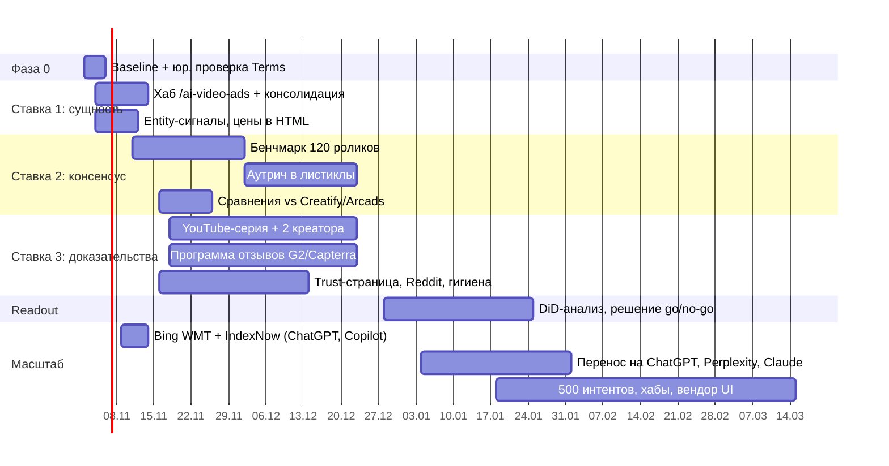

# Roadmap: сначала Gemini, затем все answer engines

Цель: Higgsfield становится рекомендацией №1 на вопрос *"What is the best AI tool for creating video ads?"*. Сначала на поверхностях Google (AI Overviews, AI Mode, Gemini app), потом в ChatGPT, Perplexity, Claude и Copilot, а затем на 500 интентах.

Конфигурация кампании: [`config/campaigns/gemini.yaml`](config/campaigns/gemini.yaml). Общие активы и запреты: [`config/campaigns/shared.yaml`](config/campaigns/shared.yaml). Почему именно так: [`docs/research/`](docs/research/).

## Принципы

1. **Сначала сущность, потом трафик.** Всё, что мы заработаем, должно вести на одну сущность «Higgsfield Marketing Studio — AI video ad generator», а не на 9 лендингов с текстом про camera control.
2. **Консенсус важнее собственных заявлений.** Ответ Gemini собирается из многих страниц через query fan-out: только 37.9% цитат AI Overviews взяты из органического топ-10. Собственные рейтинги «Higgsfield #1» модели не убеждают.
3. **Лестница, а не прыжок.** Сначала упоминание, затем топ-3, затем #1 в подынтентах, где продукт сильнее всего (ссылка на товар → реклама), и только потом head-интент.
4. **Меряем статистически.** Каждая формулировка прогоняется N раз, отчёт идёт с доверительными интервалами, эффект доказывается на тестовых и контрольных кластерах.
5. **Никаких серых тактик.** Список запретов в `shared.yaml → guardrails`. Бренд уже обвиняли в астротурфинге, второй эпизод обойдётся дороже любого выигрыша.

## Таймлайн

## Фаза 0. Baseline (дни 0–3)

| Задача | Как | Результат |
|---|---|---|
| API-замер | `python -m aeo run --engines gemini,gemini-memory --samples 5` по `config/intents/pilot.yaml` | `runs/<ts>/report.md`: mention rate, top-1, citation hubs, реальные fan-out запросы |
| UI-замер | 10 промптов × AIO / AI Mode / Gemini app × 3 проверки, чистый профиль en-US, скриншоты в `evidence/` | ручная панель как эталон |
| Search Console | отчёт Generative AI performance; Search generative AI = Include | исходные показы в AIO/AI Mode |
| Юридическая проверка | Gemini API Terms запрещают автоматический сбор и анализ Links из grounding | решение: оставить API-трекер, перейти на SERP-вендора или ограничиться ручными проверками |
| Уточнить fan-out | заменить `fanout_targets` в `gemini.yaml` реальными `webSearchQueries` из прогона | семантика для страниц и аутрича |

Gate: baseline зафиксирован по всем трём поверхностям Google.

## Фаза 1. Сущность — ставка 1 (недели 1–2, $0)

- Хаб `/ai-video-ads` по спецификации [`site/hub-ai-video-ads.md`](site/hub-ai-video-ads.md); 8 лендингов перенаправлены или канонизированы на хаб.
- Главная: новый title и блок Video Ads со ссылкой на хаб. Organization description и sameAs исправлены, OG-тексты про camera control заменены.
- `/pricing` отдаёт цены в HTML, на хабе есть Offer schema ([`site/jsonld-ai-video-ads.json`](site/jsonld-ai-video-ads.json)).
- В `llms.txt` добавлен раздел Marketing & Ads ([`site/llms-txt-ads-section.md`](site/llms-txt-ads-section.md)), в robots.txt новая группа AI-ботов ([`site/robots-ai.txt`](site/robots-ai.txt)).
- `config/brand_facts.yaml` заполнен и подтверждён продуктом.

Gate (неделя 4): хаб проиндексирован и ранжируется в Google и Bing хотя бы по 3 fan-out запросам; mention rate ≥ 40%.

## Фаза 2. Консенсус — ставка 2 (недели 2–8, $1 850)

- Бенчмарк: 10 товаров × 6 инструментов × 2 формата = 120 роликов, слепая панель из 5 медиабайеров, открытые сырые данные, честно показанные проигрыши, право на ответ для конкурентов.
- Аутрич в листиклы из `gemini.yaml → hubs.editorial` (приоритет 1: startuptalky, layer3labs, cometly ×2). Пакет для рецензента: 30 дней доступа, factsheet, 3 ролика по товару рецензента, данные бенчмарка. Без оплаты за позицию.
- Страницы сравнения vs Creatify, Arcads, Topview, MakeUGC.

Gate (неделя 8): Higgsfield в топ-3 на ≥ 4 из 12 хабов; mention rate ≥ 50%, top-3 ≥ 20%.

## Фаза 3. Сторонние доказательства и доверие — ставка 3 (недели 3–8, $2 250)

- 6 роликов «tested» на канале Higgsfield с главами и транскриптом; 2 независимых креатора из performance-маркетинга с пометкой paid partnership.
- Программа отзывов G2 и Capterra через официальные механизмы, без фильтра по тональности; запуск Marketing Studio на Product Hunt.
- `/trust/changes`: возвраты, что значит «unlimited» в цифрах, SLA выплат, модерация промо. Фактические ответы на контр-нарративы конкурентов.
- Reddit только от раскрытых аккаунтов команды: AMA и пост с данными бенчмарка.
- Гигиена: geo-субдомен переведён в noindex или сокращён до 10–15 полезных страниц, дубль в Wikidata слит.

## Фаза 4. Readout (недели 8–12)

- Difference-in-differences: тестовые кластеры (video-ads) против контрольных (ai-image, music-video), которые не делят с ними хабы.
- Сверка API-метрик с ручной UI-панелью.
- Решение по каждому рычагу: масштабировать, переделать или остановить.

Цель недели 12: mention rate ≥ 60%, top-3 ≥ 30% на unbranded video-ads кластере.

## Фаза 5. Другие движки (с недели 2 для Bing, полностью с недели 9)

Сущность, бенчмарк, сравнения и отзывы переиспользуются. Меняются индекс и рычаги:

| Движок | Индекс | Что добавить к Gemini-кампании | Конфиг |
|---|---|---|---|
| ChatGPT | свой индекс + Bing | Bing Webmaster Tools, IndexNow, ранжирование хаба и бенчмарка в Bing | [`chatgpt.yaml`](config/campaigns/chatgpt.yaml) |
| Copilot | Bing | то же + свежесть страниц сравнения (быстро затухают) | [`copilot.yaml`](config/campaigns/copilot.yaml) |
| Perplexity | собственный | Reddit, датированные таблицы с данными, ежемесячное обновление | [`perplexity.yaml`](config/campaigns/perplexity.yaml) |
| Claude | Brave | индексация в Brave, Claude-SearchBot и Claude-User в robots.txt | [`claude.yaml`](config/campaigns/claude.yaml) |
| Grok, Meta AI | X и соцсети; Google/Bing + Meta-WebIndexer | присутствие в X, Facebook и Instagram; Meta-WebIndexer разрешён | позже |

Bing-работу (Webmaster Tools + IndexNow) стоит начать уже на неделе 2: это дёшево, а один и тот же индекс питает ChatGPT, Copilot и частично Meta AI.

## Фаза 6. 500 интентов (квартал 2)

- Панель интентов: `python -m aeo expand config/intents/taxonomy.yaml --limit 500`; веса калибруются по объёмам и baseline-разрыву.
- Мониторинг по уровням: топ-100 интентов еженедельно (3 формулировки × 5 прогонов), остальные 400 раз в две недели (2 × 3). Это около 11.7 тыс. прогонов на движок в месяц, примерно $1.2–1.8 тыс. на API.
- Хабы цитирования: граф intent ↔ домен и жадное weighted set cover. Работаем с 15–25 доменами, которые покрывают большую часть веса, а не с 500 страницами.
- Buy vs build: один UI-вендор (Peec AI или Profound) как эталон интерфейса, собственный тонкий слой статистики, хабов и экспериментов поверх этого трекера.

Подробности: [`docs/research/03-scaling.md`](docs/research/03-scaling.md).

## Бюджет $5 000 (8 недель)

| Статья | Сумма | Ставка |
|---|---|---|
| Бенчмарк: подписки на 5 конкурентов, панель из 5 медиабайеров, дизайн отчёта | $1 500 | 2 |
| PR и аутрич | $350 | 2 |
| YouTube: 2 креатора с раскрытием, монтаж 6 роликов | $1 500 | 3 |
| G2/Capterra: стимулы по официальной программе | $750 | 3 |
| Мониторинг | $400 | все |
| Резерв | $500 | |
| **Итого** | **$5 000** | |

Ставка 1 оплачивается только временем команды.
