# 03. Масштабирование AEO/GEO для Higgsfield: от 1 интента к 500 и от Gemini ко всем answer engines

*Дата среза: 2026-10-28. Легенда: **[V]** проверено по первичному источнику (официальная документация, страница вендора, наш собственный запрос); **[R]** сообщается третьей стороной (исследование, СМИ); **[I]** вывод или оценка автора. Для слабых данных указана уверенность (High / Med / Low).*

---

## TL;DR

- **Что ломается.** Подход пилота («задать вопрос в Gemini, посмотреть, написать страницу») на 500 интентах ломается по четырём осям: (1) измерение: ответы LLM недетерминированы, один скриншот это шум, а нужная выборка × 500 интентов × 7+ поверхностей невыполнима вручную; (2) производство: страница на интент упирается в бюджет и в спам-политики; (3) приоритизация: интенты неравноценны; (4) атрибуция: без контрольных групп рост не доказать.
- **Единица работы меняется** с «промпта» на **кластер интентов** (use case × persona × platform × funnel × locale) для измерения и на **citation hub** (домен или URL, цитируемый во многих интентах) для действий.
- **Мониторинг:** официальные API как статистический слой (OpenAI Responses + `web_search`, Perplexity Agent API, Anthropic `web_search_20250305`, Gemini `google_search`), SERP-вендоры для AIO, AI Mode, Copilot, плюс UI-вендор для калибровки, потому что API и UI совпадают по брендам лишь на 15–32% (Surfer, 2026).
- **Стоимость:** продуманный tiering даёт ~11.7k прогонов на движок в месяц и ~$1.2–1.8k API-затрат против ~$80k у наивной схемы.
- **Метрики:** mention rate с Wilson CI на уровне кластера как основа; top-1 rate, position-weighted visibility, share of voice, owned citation share, accuracy и source coverage; всё сводится в Visibility Index с весами движков.
- **Buy vs build:** гибрид. Покупаем UI-«правду» у одного вендора (Peec или Profound), строим собственный тонкий слой статистики, графа хабов и экспериментов.
- **Срочные находки по Higgsfield:** `robots.txt` открывает локали `/es/ /ja/ /ko/ /de/ /zh/` для Googlebot и Bingbot только через ручной allowlist (~46 / 9 / 18 / 9 / 0 URL); ~50 самопродвигающих GEO-страниц на `geo.higgsfield.ai` без canonical. При масштабировании это первые задачи.

---

## 1. Engine map

| Движок | Retrieval / индекс | Боты: search · user · training | Цитаты в UI | Смещения по источникам (цифры) | Главный рычаг |
|---|---|---|---|---|---|
| **Google AI Overviews / AI Mode** | Индекс и ранжирование Google Search + query fan-out; достаточно быть проиндексированным и snippet-eligible [V] | Googlebot · n/a · Google-Extended **не влияет** на AIO/AI Mode [V]; opt-out через переключатель в Search Console (июнь 2026) или `nosnippet` [V] | Inline-ссылки, блок «dive deeper» с карточками, hover-превью (обновление 15.10.2026) [V] | AIO: YouTube 9.5%, Wikipedia 8.4%, Reddit 7.4%, Quora 3.6% (Ahrefs, 76.7M AIO) [V]; 76.1% цитат из топ-10 (Ahrefs, 07.2025) [V], в повторном замере только 38% [R]; AI Mode: LinkedIn ~15%, Reddit ~3% (Semrush) [V] | Органика Google (топ-100, не только топ-10), YouTube, Reddit/Quora; отчёт GSC Generative AI |
| **Gemini app** | Grounding на Google Search [V] | Googlebot · n/a · Google-Extended управляет обучением **и** grounding в Gemini app [V] | Кнопка Sources и inline, боковая панель; не у каждого ответа [V] | Только 8.6% цитат совпадают с топ-10 Google (Ahrefs) [V]; доля веб-трафика AI 27–28% (Similarweb, 05.2026) [V] | Как Google SEO + не блокировать Google-Extended |
| **ChatGPT search** | Собственный индекс (OAI-SearchBot) + сторонние провайдеры: Bing [R], выдача Google через скрейперов [R]; по Peec собственный индекс + ~8 провайдеров [R] | OAI-SearchBot (robots.txt соблюдается) · ChatGPT-User (robots.txt «may not apply») · GPTBot; ещё OAI-AdsBot для рекламы [V] | Inline-«пилюли» + панель Sources; с 08.2026 у части платных аккаунтов «View sources» спрятан в меню [R] | 87% цитат совпадают с топом Bing (Seer, 2025) [V]; Wikipedia 16.3% (Ahrefs) / 7.8% (Profound) [V]; доля Reddit упала с ~60% до ~10% промптов в 09.2025 (Semrush) [V]; лучше всего цитируются листиклы [R] | Разрешить OAI-SearchBot; Bing Webmaster Tools + IndexNow; присутствие в листиклах |
| **Perplexity** | Собственный индекс «hundreds of billions of webpages» [V], на Vespa [R] | PerplexityBot (не для обучения) · Perplexity-User («generally ignores robots.txt») · n/a [V] | Нумерованные сноски inline + список источников [R] | Reddit 6.6% всех цитат и 46.7% внутри топ-10 доменов (Profound) [V]; YouTube 16.1%, Wikipedia 12.5% (Ahrefs) [V]; самое высокое совпадение с топ-10 Google, 28.6% [V] | Разрешить PerplexityBot; свежесть; Reddit, YouTube |
| **Claude** | Brave Search (в списке субпроцессоров с 03.2025, совпадение выдачи 79–87%) [R]; с 05.2026 также turbopuffer [R] | Claude-SearchBot · Claude-User (соблюдает robots.txt) · ClaudeBot [V] | Прямые inline-цитаты [V] | Цитирует журналистику реже других [R]; данных мало (Low) | Индексация в Brave; разрешить Claude-SearchBot и Claude-User |
| **Microsoft Copilot** | Bing [V]; Bing Search API закрыт 11.08.2025, вместо него Grounding with Bing [R] | Bingbot; управление через `NOARCHIVE` / `NOCACHE` [V] | Inline-ссылки на уровне предложений + полный список ссылок [V] | Совпадение с топ-10 Bing 16.6% (Ahrefs) [V]; у одного сайта одна сравнительная страница собрала 69% цитирований Copilot (Search Influence) [R] | Bing WMT (отчёт AI Performance) + IndexNow |
| **Grok** | Инструменты X Search + Web Search [V]; поисковый провайдер не раскрыт | Документированного краулера нет; фетчи с подменёнными UA [R]: robots.txt не работает | Список источников | Reddit 16.3%, YouTube 15.1%, Facebook 13.9%, X всего 1.4% (Ahrefs, 06.2026) [V]; другая оценка ~45% X-постов [R], методики расходятся | Присутствие в X и соцсетях / UGC |
| **Meta AI** | Результаты Google и Bing [R] + собственный индекс через Meta-WebIndexer [V] | meta-webindexer · Meta-ExternalFetcher (может игнорировать robots.txt) · Meta-ExternalAgent [V] | Ссылки и карточки источников (Low) | Нет надёжных данных (Low) | Разрешить Meta-WebIndexer; Facebook/Instagram |
| **DeepSeek** (опц.) | Собственный поисковик; Search API с 10.2026 [R] | DeepSeekBot не документирован [R] | n/a | n/a | Низкий приоритет для US-аудитории |

**Заметки по карте:**
- **Типы источников поверх движков.** Листиклы «best X» доминируют: 63% цитат у Evertune, 70.8% в B2B-выборке (1 263 промпта, Q2 2026), 21.9% у Wix; методики сильно различаются [R]. Earned media 82–84% цитат, платный контент 0.3% (Muck Rack «What is AI Reading?») [R]. Review-сайты в B2B: сеть G2 ~8% [V, исследование вендора]. Вывод для Higgsfield: для запросов «best AI tool for…» решают сторонние листиклы, YouTube-обзоры и Reddit, а не собственные страницы.
- **Веса движков для индекса.** Доли AI-трафика по Similarweb (06.2025 → 05.2026): ChatGPT ~76% → 53%, Gemini <9% → 27–28%, Claude ~9% [V]. Плюс AIO/AI Mode по объёму Google Search. Это стартовые `w_e`, пересматриваются ежеквартально.
- **Bing это общий знаменатель** для Copilot, частично ChatGPT и Meta AI; **Google** для AIO, AI Mode, Gemini и частично ChatGPT; **Brave** для Claude. Поэтому техническая база одна на всех: индексируемость в трёх индексах + IndexNow.
- **Агентные браузеры** (ChatGPT Atlas, Comet, Copilot Mode в Edge) и Grok ходят с UA, похожими на Chrome, поэтому robots.txt и UA-фильтры на них не действуют [R]; в логах их нужно выделять иначе.
- **Cloudflare** с 07.2025 по умолчанию блокирует AI-краулеры для новых доменов и предлагает pay-per-crawl [V]. higgsfield.ai стоит за Cloudflare (заголовок `Server: cloudflare`); наши запросы с UA OAI-SearchBot, Claude-SearchBot, PerplexityBot, bingbot, GPTBot получили 200 [V], но с реальных IP ботов правила могут отличаться. Нужна сверка с настройками AI Crawl Control и логами.
- **Рекомендованная группа robots.txt** (search/retrieval и user-fetchers явно разрешить, решение по training-ботам принимает бизнес): `OAI-SearchBot`, `ChatGPT-User`, `PerplexityBot`, `Perplexity-User`, `Claude-SearchBot`, `Claude-User`, `Googlebot`, `Bingbot`, `Applebot`, `meta-webindexer`, `Meta-ExternalFetcher`; training: `GPTBot`, `ClaudeBot`, `Meta-ExternalAgent`, `CCBot` (для бренда, которому важно попадать в параметрическую память моделей, рекомендую разрешать, как сейчас); opt-out токены: `Google-Extended` (влияет на grounding в Gemini app, поэтому не блокировать), `Applebot-Extended` (только обучение Apple). Устаревший `Claude-Web` из текущего файла убрать.

---

## 2. Programmatic monitoring APIs (состояние на конец октября 2026)

Официальные API дают дешёвый, воспроизводимый и легальный сигнал, но это **не тот продукт**, что видит пользователь (см. 2.6). Поэтому два слоя: API как статистическая панель, UI-выборка как калибровка.

### 2.1 OpenAI: Responses API + `web_search` [V]

```bash
curl https://api.openai.com/v1/responses \
  -H "Authorization: Bearer $OPENAI_API_KEY" -H "Content-Type: application/json" \
  -d '{
    "model": "gpt-6.1-sol",
    "tools": [{"type": "web_search",
               "user_location": {"type": "approximate", "country": "US"},
               "search_context_size": "medium"}],
    "include": ["web_search_call.action.sources"],
    "input": "What is the best AI tool for creating video ads?"
  }'
```

- Тип инструмента `"web_search"`; `"web_search_preview"` это legacy без фильтров. Параметры: `filters.allowed_domains / blocked_domains` (до 100), `user_location`, `search_context_size` (`low|medium|high`). [V]
- Ответ: `output[]` содержит `web_search_call` (`action.type` = `search | open_page | find_in_page`) и `message`, где `content[].annotations[]` это `{"type": "url_citation", "url", "title", "start_index", "end_index"}`. Полный список просмотренных URL приходит в `sources` при `include: ["web_search_call.action.sources"]`; «источники» и «цитаты» храним раздельно. [V]
- Модели: пример в документации на `gpt-6-astra` (флагман, $10 / $50 за 1M). У `gpt-6.1-sol` ($2 / $10, DevDay 29.09.2026) и `gpt-6-luna` ($0.10 / $0.50) `web_search` есть в списке инструментов. Для трекера: `gpt-6.1-sol` основной, `gpt-6-luna` дешёвый широкий слой. [V]
- Цена: `web_search` **$10 / 1k вызовов** + search content tokens по тарифу модели (`web_search_preview` для non-reasoning: $25 / 1k, контент бесплатно). [V] Прогон: ~$0.04 (`gpt-6.1-sol`), ~$0.016 (`gpt-6-luna`) [I, Med].

### 2.2 Perplexity: Sonar ушёл, теперь Agent API [V]

**Sonar Chat Completions выведен из поддержки 27.09.2026**: синхронные запросы пока переформулируются в Agent API, асинхронные не работают. Маппинг: `sonar`, `sonar-pro` → effort `fast`; `sonar-reasoning-pro` → `low`; `sonar-deep-research` → `high` / `xhigh`. [V]

```bash
curl https://api.perplexity.ai/v1/agent \
  -H "Authorization: Bearer $PERPLEXITY_API_KEY" -H "Content-Type: application/json" \
  -d '{
    "model": "perplexity/sonar",
    "input": "What is the best AI tool for creating video ads?",
    "tools": [{"type": "web_search",
               "filters": {"search_recency_filter": "month"},
               "user_location": {"country": "US"}}]
  }'
```

- Endpoint `POST https://api.perplexity.ai/v1/agent` (алиас `/v1/responses` для OpenAI SDK). Нативная модель `perplexity/sonar`; доступны и сторонние `provider/model` (`openai/gpt-6.1-sol`, `anthropic/claude-sonnet-5-5`, `google/gemini-4-argon`). Вместо `model` можно передать `effort: "fast"`. [V]
- Цитаты: в старом API были верхнеуровневые `citations[]` и `search_results[]`. Теперь это элементы `output[]` с `type: "search_results"` (`queries[]`, `results[]`: `id`, `url`, `title`, `snippet`, `date`, `source`), а в тексте `message` маркеры `[n]` ссылаются на `results[].id`. [V] Парсер поддерживает оба формата.
- Цены: `perplexity/sonar` $0.25 / $2.50 за 1M; `web_search` $2.50 / 1k вызовов (fast $1 / 1k); Search API $5 / 1k. [V] Прогон ~$0.007 [I]. Ответ API не равен perplexity.ai, где пользователь выбирает модель и режим [I, High].

### 2.3 Anthropic: Messages API + web search tool [V]

```json
{
  "model": "claude-sonnet-5-5",
  "max_tokens": 2048,
  "messages": [{"role": "user", "content": "What is the best AI tool for creating video ads?"}],
  "tools": [{"type": "web_search_20250305", "name": "web_search", "max_uses": 5,
             "user_location": {"type": "approximate", "country": "US"}}]
}
```

- Версии: `web_search_20250305` (базовая), `web_search_20260209` (dynamic filtering кодом), `web_search_20260318` (+ `response_inclusion`); имя всегда `web_search`. Параметры: `max_uses`, `allowed_domains` **или** `blocked_domains`, `user_location`, `allowed_callers`. [V] Для мониторинга берём базовую версию: проще парсинг и поведение ближе к обычному поиску [I].
- Ответ: `server_tool_use` (запрос), `web_search_tool_result` (`web_search_result`: `url`, `title`, `page_age`, `encrypted_content`), текстовые блоки с `citations[]` типа `web_search_result_location` (`url`, `title`, `cited_text` до 150 символов, `encrypted_index`); счётчик `usage.server_tool_use.web_search_requests`. [V]
- Модели: `claude-opus-5-5` ($4 / $20), `claude-sonnet-5-5` ($2 / $10), `claude-haiku-5-5` (от $0.10 / $0.50); Batch API −50% на токены. Поиск **$10 / 1k searches** + токены результатов. [V] Прогон ~$0.02–0.05 [I].

### 2.4 Gemini API: Grounding with Google Search (кратко) [V]

Текущая документация описывает Interactions API: `POST https://generativelanguage.googleapis.com/v1beta/interactions`, тело `{"model": "gemini-3.8-flash", "input": "...", "tools": [{"type": "google_search"}]}`. В ответе шаги `google_search_call` / `google_search_result` и `url_citation` аннотации со `start_index` / `end_index`. Для Gemini 3+ оплата **за каждый поисковый запрос** модели: 5 000 бесплатно в месяц, далее **$14 / 1k**; `gemini-3.8-flash` $0.75 / $3.75 за 1M до 31.12.2026, с 01.01.2027 вдвое дороже. [V] Grounding в API не равен ни AI Overviews / AI Mode, ни приложению Gemini. Детали в отчёте коллеги.

### 2.5 Поверхности без официального API: AI Overviews, AI Mode, Copilot, Gemini app, Grok, Meta AI

| Вариант | Что даёт | Цена | Риски |
|---|---|---|---|
| DataForSEO SERP: Google AI Mode `/v3/serp/google/ai_mode/task_post/` (+ `live/advanced`, `live/html`); AIO как элемент `ai_overview` в Google Organic SERP с `load_async_ai_overview: true` | Текст ответа и references | AI Mode: $1.20 / 1k (standard), $2.40 (priority), $4.00 (live); AIO: +$0.002 к запросу SERP, возвращается, если AIO нет [V] | Скрейпинг Google на стороне вендора |
| DataForSEO AI Optimization API | LLM Responses (ChatGPT, Claude, Gemini, Perplexity через API), LLM Scraper (ChatGPT, Gemini UI), LLM Mentions, AI Keyword Data | по запросу [V] | Scraper нарушает ToS платформ [I] |
| SerpApi: `engine=google_ai_mode`, `engine=google_ai_overview` (нужен `page_token` из обычного Google SERP, живёт 1 минуту), `engine=bing_copilot` (запущен 16.06.2026) | `text_blocks`, `references` (`title`, `link`, `source`, `index`) | планы $75 / 5k, $150 / 15k, $725 / 100k в месяц [V] | см. ниже |
| Bright Data AI scrapers (ChatGPT, Copilot, Perplexity и др.) | UI-ответы с источниками | по объёму [R] | ToS |
| Собственная браузерная автоматизация (Playwright, залогиненные аккаунты) | Максимально близко к UI | дорого в поддержке | Баны аккаунтов, ToS |
| Первичные отчёты платформ | Bing Webmaster Tools **AI Performance** (public preview с 10.02.2026: цитирования в Copilot, AI-сводках Bing и у партнёров, цитируемые страницы, grounding queries) [V]; пока только CSV, API в планах [R]. Google Search Console **Generative AI performance** (с 03.06.2026: показы в AIO + AI Mode и Discover по страницам и странам) [V]; без кликов, запросов и разбивки AIO vs AI Mode [R] | бесплатно | Агрегированы, без промптов; но это единственные данные «изнутри» платформ |

ToS и право: Google ToS запрещают «automated means to access content ... in violation of ... robots.txt», а `google.com/robots.txt` закрывает `/search` [V]. Google подал иск к SerpApi (декабрь 2025); в июле 2026 суд отклонил DMCA-претензию с правом подать уточнённый иск [R]. OpenAI Terms of Use прямо запрещают «Automatically or programmatically extract data or Output» [R, по тексту ToU в индексе]. Вывод: скрейпинг UI допустим только через вендора, который несёт риск, никогда с корпоративных аккаунтов Higgsfield; основной статистический слой строим на официальных API. [I]

### 2.6 API ≠ UI: как это учитывать

Причины: другая модель и роутинг, системный промпт и формат (карточки, видео, карусели), персонализация и память, геолокация, глубина query fan-out, A/B-тесты. [I, High] Данные: исследование Surfer (август 2026, 1 000 промптов, 13 779 ответов, ChatGPT, Perplexity, Gemini, AI Mode, AIO) показало пересечение брендов API vs UI всего **15.5–23.8%** (21.3–31.6% после нормализации названий); API называет до 1.85× больше брендов (ChatGPT: 13.8 vs 7.9) и пишет до 2× длиннее; у ChatGPT в приложении 12.1 источника против 3.1 в API, у Perplexity наоборот 19.5 в API против 10.3 в приложении; пересечение доменов 4.8–26.7% [V]. Лидеры рынка (Profound, Peec) собирают данные именно из UI, а не через API [V]. Вывод: API-метрики нельзя выдавать за «то, что видит пользователь»; это дешёвый статистический прокси для направления и относительных изменений.

Калибровка [I]: (1) ежемесячно 50 промптов × 10 сэмплов параллельно через API и UI-источник (вендор или чистые профили в 3 локалях); (2) уровни не сравниваем (они заведомо разные), а проверяем **согласие направлений**: корреляцию недельных изменений MR по кластерам между API и UI и пересечение топ-доменов; (3) если корреляция ниже ~0.5, API этого движка используется только как ранний индикатор, а KPI считаются по UI-выборке; (4) смена model id или версии инструмента это разрыв ряда: фиксируем в логе и пересчитываем базовую линию.

---

## 3. Что ломается при 500 интентах

| # | Что ломается | Почему | Масштаб проблемы |
|---|---|---|---|
| 1 | Ручная проверка | 500 интентов × 7 поверхностей × 10 сэмплов = 35 000 ответов за цикл; по 1 минуте это ~580 часов | Невыполнимо [I] |
| 2 | Недетерминизм LLM | SparkToro/Gumshoe (2 961 ответ, ChatGPT, Claude, AIO/AI Mode): шанс получить тот же список брендов дважды < 1/100, тот же порядок < 1/1000; частота упоминания при этом стабильнее [V]. AirOps: только 30% брендов остаются видимыми между соседними ответами, 20% на 5 прогонах подряд [V]. Статистически: при n = 10 и 50% упоминаний 95% Wilson CI [24%; 76%]; n = 30 [33%; 67%]; n = 100 [40%; 60%] | Решения по одиночным скриншотам случайны; «позиция в AI» без выборки ничего не значит |
| 3 | Вариативность формулировок | 142 написанных людьми промпта на один и тот же интент имели среднюю семантическую близость всего 0.081 [V, SparkToro]. Плюс персоны, локали, языки | Один «канонический» промпт не репрезентативен |
| 4 | Контент как бутылочное горлышко | Одна сильная страница на интент = 500 страниц; без шаблонов и данных это либо месяцы, либо тонкий контент | Риск Google spam policy «scaled content abuse» |
| 5 | Приоритизация | Без единой формулы решает самый громкий голос; 500 интентов неравноценны по спросу и выручке | Распыление бюджета |
| 6 | Атрибуция | Параллельно меняются контент, PR, модели движков, сезонность; без контрольной группы прирост недоказуем | «Выросли, но не знаем почему» |
| 7 | Стоимость мониторинга | Наивно: 500 × 3 формулировки × 10 сэмплов × 6 движков × ежедневно = 2.7 млн вызовов в месяц, ~$80k | Нужен tiering [I, расчёт] |
| 8 | Расхождение движков | Разные индексы (Google, Bing, Brave, собственные), разные предпочтения по источникам; победа в AIO не переносится в ChatGPT | Один playbook на всех не работает |
| 9 | Каннибализация и фрагментация сущности | Несколько страниц Higgsfield конкурируют за один интент, движок цитирует устаревший пост вместо актуальной страницы; бренд размывается между названиями фич (Soul, Cinema Studio, Click-to-Ad, UGC Factory) | Падение citation share собственного домена |
| 10 | Техническая гигиена | См. ниже наблюдения по higgsfield.ai | Тихие блокеры для целых кластеров |

**Наблюдения по текущему состоянию Higgsfield (проверено 2026-10-28) [V]:**
- `higgsfield.ai/robots.txt`: ~1 160 строк, из них ~1 000 ручных `Allow`. Для `User-Agent: *` (Googlebot, Bingbot) закрыты `/es/ /ja/ /ko/ /de/ /zh/`, открыты только перечисленные URL: ~46 es, ~18 ko, ~9 ja, ~9 de, 0 zh. Allowlist осознанный, но не масштабируется: каждая новая локализованная страница под интент без правки robots.txt невидима для индексов Google и Bing (AIO, AI Mode, Copilot, частично ChatGPT). Нужен robots.txt как код, генерируемый из реестра страниц. Группа AI-ботов называет GPTBot, OAI-SearchBot, ChatGPT-User, ClaudeBot, устаревший Claude-Web, PerplexityBot, Perplexity-User, Google-Extended; Claude-SearchBot, Claude-User, Applebot, meta-webindexer наследуют правила `*`.
- `geo.higgsfield.ai` уже содержит ~50 программных страниц-ответов («Best AI Tools for Regular Ad Production Without a Team» и т.п.): ~1 600 слов, первый абзац «start with Higgsfield», без `canonical` и JSON-LD; часть ранее проиндексированных URL отдаёт 404, `robots.txt` и `sitemap.xml` поддомена отдают 500. Это подход «страница на интент», и на 500 интентах он упирается в доверие: самопровозглашённые рейтинги на своём поддомене слабо убеждают модели, которые ищут независимое подтверждение [I, Med].

---

## 4. Redesign

### 4a. Таксономия интентов: как получить 500 и не утонуть

**Измерения:** `use_case × persona × platform × funnel_stage × modifier × locale`. Полное произведение даёт десятки тысяч комбинаций; выбираем 500 канонических интентов и к каждому 3–5 парафраз.

**Пайплайн [I]:** (1) сырьё: запросы GSC и Bing WMT (включая grounding queries), People Also Ask, Reddit (r/PPC, r/aivideo, r/ecommerce), заголовки конкурентных листиклов, саппорт и sales-звонки, объёмы AI-запросов (DataForSEO AI Keyword Data, Profound Prompt Volumes), LLM-расширение по сетке; (2) дедупликация по embeddings (cos > 0.9); (3) кластеризация (HDBSCAN), LLM-ярлыки, человек утверждает дерево L1 → L2; (4) отбор по priority score (4b) с покрытием всех стадий воронки; (5) ежемесячная ревизия: новые модели генерации видео и тренды добавляют интенты, мёртвые уходят в `retired`.

**Пример таксономии для Higgsfield (L1, ~500 интентов):**

| L1 кластер | Примеры интентов | Персоны | Платформы | Квота |
|---|---|---|---|---|
| Video ads | best AI tool for video ads; AI ad generator from product URL; how to make 50 ad variations a week | performance marketer, DTC founder, agency | Meta Ads, TikTok Ads, YouTube | 70 |
| UGC и AI-аватары | best AI UGC video generator; AI actors for TikTok ads; UGC without creators | DTC, e-com, агентство | TikTok, Reels | 55 |
| Product videos / e-commerce | AI product video from photo; Shopify product video AI; Amazon listing video | e-com manager, Shopify merchant | Shopify, Amazon | 45 |
| Social content | AI tool for Reels/Shorts; viral AI video effects; faceless channel tools | creator, SMM | TikTok, Instagram, YouTube Shorts | 60 |
| Music videos | AI music video generator; lyric video AI; visuals for a song | музыкант, лейбл | YouTube, Spotify Canvas | 30 |
| Film previs / cinematic | AI storyboard to video; camera control AI video; AI short film tools | режиссёр, студия, продакшн | n/a | 45 |
| Character consistency / AI influencer | consistent character across videos; create AI influencer | creator, бренд | Instagram, TikTok | 40 |
| Model access / aggregator | where to use Veo / Sora / Kling / Seedance; one subscription for all video models | prosumer, developer | n/a | 50 |
| Pricing и value | cheapest AI video generator; unlimited AI video plan; commercial license AI video | все | n/a | 35 |
| Teams / enterprise / API | AI video platform for agencies; AI video API for developers; brand safety | агентство, enterprise, developer | n/a | 30 |
| Alternatives / vs | Runway alternative; Higgsfield vs Kling; HeyGen vs Higgsfield for ads | все | n/a | 40 |
| **Итого** | | | | **500** |

Стадии воронки внутри каждого L1: `category_discovery` («best X for Y»), `comparison` («X vs Y», «alternatives»), `how_to` («how to make…»), `evaluation` («is X worth it», цены, лицензия, отзывы). Локали стартово: en-US (60%), en-GB/en-IN, es, pt-BR, ja, ko, de.

### 4b. Prioritization score

$$
\text{Priority}_i = \frac{D_i^{\,0.5}\cdot V_i \cdot G_i \cdot W_i}{E_i}
$$

- **D (Demand)**: объём промптов (AI keyword volume, показы GSC/Bing, частота в Reddit/PAA), 0–1; корень гасит доминирование «головы».
- **V (Business value)**: P(конверсия персоны) × ARPU × стратегический вес (ads и UGC выше music videos), 0–1.
- **G (Gap)**: `1 − VI_i`, текущий Visibility Index интента (4e).
- **W (Winnability)**: `product_fit × hub_accessibility × (1 − entrenchment)`: действительно ли Higgsfield лучший ответ (если нет, только защищаем упоминание); доля веса топ-хабов, где присутствие реально получить; доля top-1 у лидера за 8 недель.
- **E (Effort)**: часы контента + PR + бюджет, 1–5.

Пример: «best AI tool for video ads» (D 0.9, V 0.95, G 0.7, W 0.6, E 3) ≈ 0.13; «AI lyric video generator» (D 0.3, V 0.3, G 0.9, W 0.8, E 1) ≈ 0.12: формула поднимает и дешёвые победы. Портфель: 70% ресурсов на топ по score, 20% на стратегические кластеры, 10% на эксперименты. [I]

### 4c. Стратегия citation hubs

На 500 интентах нельзя работать «по интенту», но цитирования концентрированы, поэтому работаем «по источнику»:

1. Двудольный граф `intent ↔ cited URL ↔ domain` по прогонам за 4 недели; вес ребра = частота цитирования × priority интента × вес движка.
2. Для каждого домена и URL: **coverage** = Σ priority интентов, где он цитируется, и citation share по движкам.
3. Выбор k хабов жадным **weighted set cover**: на каждом шаге домен с максимальным приростом покрытого priority-веса. Ожидаемо 15–25 доменов покроют 60–80% веса [I, Med; проверяется на данных].
4. Тип действия по хабу: **owned** (higgsfield.ai, YouTube-канал, help center, API docs); **earned editorial** (листиклы «best AI video generators 2026»: обновление одного листикла, цитируемого в 40 интентах, двигает все 40); **review** (G2, Capterra, Product Hunt, app stores); **community** (Reddit, YouTube-обзоры креаторов, Discord, X для Grok); **reference** (Wikipedia / Wikidata только по правилам notability и COI).
5. Метрика **source coverage**: доля веса хабов, где Higgsfield присутствует и описан корректно (проверяет краулер цитируемых URL).

Почему это работает: распределение цитирований по доменам подчиняется степенному закону [V, arXiv 2603.08924]; в AIO четыре домена (YouTube, Wikipedia, Reddit, Quora) дают ~29% цитат [V, Ahrefs]; листиклы и earned media составляют большинство цитат во всех движках (см. заметки к разделу 1). Кейс Search Influence показывает и обратную сторону: одна сравнительная страница собрала 69% цитирований сайта в Copilot, но за два месяца цитирования упали на 97% [R]. Значит, хабы надо не только «захватывать», но и поддерживать свежими, а граф пересчитывать ежемесячно.

### 4d. Контент-система

**Шаблоны, каждый с уникальными данными [I]:** (1) **use-case hub** (`/use-cases/video-ads`): answer-first абзац 40–60 слов, таблица «для кого / что получите / ограничения», 3–5 реальных генераций с промптами; (2) **persona × use case** только при наличии уникального кейса или отзыва; (3) **comparison** (`/compare/higgsfield-vs-runway`): честная таблица фактов и «когда выбрать конкурента»; (4) **model pages** (`/models/veo`, `/models/kling`): Higgsfield как агрегатор моделей, уникальная позиция для интентов «где использовать модель X»; (5) **how-to** с видео, транскриптом, `VideoObject`; (6) **fact sheet / pricing / changelog**.

**Конвейер:** brief из записи интента и хабов → черновик (LLM + шаблон) → обязательные уникальные ассеты (генерации, цифры) → редактор → сверка с fact sheet → публикация → IndexNow + sitemap → интент автоматически встаёт в «наблюдение после изменения».

**Quality gates** против «scaled content abuse» (Google: «many pages are generated for the primary purpose of manipulating search rankings») [V]: минимум два уникальных элемента на страницу, лимит публикаций в неделю на кластер, без страниц-сирот; лучшие страницы `geo.higgsfield.ai` переносим на основной домен с 301.

**Консистентность сущности:** один `brand_facts.yaml` (позиционирование одной фразой, категория, фичи, цены, модели, лицензия) питает сайт, `Organization` / `SoftwareApplication` JSON-LD, press kit, G2 / Capterra / Product Hunt / Crunchbase / LinkedIn / app stores, Wikidata. Ежемесячно сверяем, что движки говорят о Higgsfield, с fact sheet: так считается **accuracy rate** и появляются задачи на исправление источников.

### 4e. Измерительный пайплайн и метрики

Поток: **prompt panel** (реестр интентов и парафраз) → **scheduler** (tiering и план сэмплов) → **runners** по движкам → **raw store** (полный JSON ответа, модель, версия инструмента, локаль, время) → **parser** (извлечение брендов с alias-резолвом, ранга, цитат, тональности через LLM-judge с выборочной ручной проверкой) → **metrics store** → **dashboard** → **alerts**.

**Сэмплинг [I]:** Tier A (топ-100 по priority): 3 парафразы × 5 сэмплов, еженедельно. Tier B (400): 2 парафразы × 3 сэмпла, раз в две недели. Итого ~11 700 прогонов на движок в месяц. Стоимость API при 7 поверхностях: ~$1 200–1 800 в месяц (OpenAI ~$190–490, Anthropic ~$250–550, Gemini ~$430, Perplexity ~$80, DataForSEO AI Mode и AIO ~$40, SerpApi Copilot план $150). Против ~$80k для наивной схемы. [I, Med: токены зависят от длины ответов]

**Статистика:** считаем на уровне кластера, а не промпта. Чтобы увидеть рост MR с 20% до 40% (α = 0.05, мощность 0.8), нужно ~82 независимых наблюдения на группу; с 30% до 40% уже ~356. Сэмплы одного промпта коррелированы: делим на design effect `DE = 1 + (m − 1)·ICC` (m = 5, ICC = 0.5 → DE = 3). Отсюда кластер ≥ 20 интентов × 3 парафразы × 3–5 сэмплов [V, расчёт; ICC допущение]. Внешние данные согласуются: Evertune ±6 п.п. только при ~100 повторах на промпт [V]; arXiv 2603.08924: стабилизация после 33–94 ответов, многие различия между доменами «в пределах шума» [V/R]; ±5 п.п. дают и 1 промпт × 385 прогонов, и 50 промптов × 8 [R]. Средний ранг публикуем только по кластеру и вместе с MR.

**Определения метрик** (R это множество ответов в срезе движок × кластер × период; b это бренд):

| Метрика | Формула | Смысл |
|---|---|---|
| Mention rate | `MR_b = Σ_r 1[b ∈ answer_r] / \|R\|` + Wilson 95% CI | Как часто нас вообще называют |
| Top-1 rate | `T1_b = Σ_r 1[rank_r(b) = 1] / \|R\|` | Цель кейса: «#1 recommended» |
| Average rank | `AR_b = mean(rank_r(b) \| b ∈ answer_r)` | Условный ранг, смотреть вместе с MR |
| Position-weighted visibility | `PV_b = Σ_r (1/rank_r(b)) / \|R\|` (0, если нет) | MRR-подобная сводка MR и ранга |
| Share of voice | `SoV_b = Σ_r w(rank_r(b)) / Σ_r Σ_{b'∈B} w(rank_r(b'))`, `w(k) = 1/k` | Доля среди конкурентного набора B |
| Citation share (owned) | `CS = #цитат на owned-домены / #всех цитат` | Нас цитируют или только упоминают |
| Owned citation rate | `Σ_r 1[∃ owned URL ∈ C_r] / \|R\|` | Доля ответов с нашей ссылкой |
| Sentiment | `mean(s_r(b))`, `s ∈ {−1, 0, +1}` по ответам с упоминанием | Тон; плюс доля негативных |
| Accuracy rate | доля ответов, где факты о Higgsfield совпадают с fact sheet | Галлюцинации о ценах и фичах |
| Source coverage | `Σ_{d∈H} w_d·1[present_d] / Σ_{d∈H} w_d` | Присутствие на хабах кластера |
| Visibility Index | `VI = Σ_e w_e Σ_c w_c (0.4·MR + 0.3·PV + 0.2·T1 + 0.1·CS)` | Северная звезда; `w_e` по доле аудитории движка |

**Alerts:** падение MR кластера ниже нижней границы CI базовой линии две недели подряд; появление нового конкурента в топ-3 более чем в 20% ответов кластера; accuracy rate < 90%; резкий рост цитирований домена, где нас нет; смена model id у API-движка.

### 4f. Операционная модель

**Роли [I]:** AEO lead (Visibility Index, приоритизация, эксперименты); analytics engineer (панель, раннеры, парсер, алерты); data analyst (статистика, граф хабов, атрибуция); content lead + 2–3 редактора + video producer; digital PR / partnerships (листиклы, креаторы, review-платформы); community manager (Reddit, YouTube, Discord, X); technical SEO (robots.txt как код, локали, schema, IndexNow, логи ботов); product marketing (позиционирование, `brand_facts.yaml`).

**Недельный ритм:** Пн: обновление метрик и разбор аномалий. Вт: приоритизация бэклога по score. Ср–Чт: продакшн и outreach. Пт: ревью экспериментов, запись всех изменений в intervention log. Ежемесячно: UI-калибровка, ревизия панели и таксономии. Ежеквартально: пересмотр весов движков, buy vs build.

**Дизайн экспериментов:** кластерная рандомизация. Пары кластеров сопоставляются по базовому MR, движкам и спросу; в каждой паре случайно назначаем test и control. Интервенция 4–6 недель. Эффект difference-in-differences: `Δ = (MR_test,post − MR_test,pre) − (MR_ctrl,post − MR_ctrl,pre)`, CI через bootstrap по интентам. Против spillover контрольные кластеры выбираем так, чтобы они не делили топ-хабы с тестовыми (расстояние в графе хабов). Периоды обновлений моделей движков исключаем или моделируем как фиксированный эффект. Для хаб-интервенций (один листикл на 40 интентов) используем pre/post с synthetic control из незатронутых кластеров.

### 4g. Buy vs build

| Инструмент | Цена (месяц) | Промпты | Движки | Сбор | Заметки |
|---|---|---|---|---|---|
| Profound | Trial бесплатно; Enterprise custom, оценки ~$1.5–5k+ [R] (Starter $99 / Growth $399 сняты в сентябре 2026 [R]) | custom | до 9: ChatGPT, Perplexity, AI Mode, Gemini, Copilot, DeepSeek, Claude, AIO, Exa [V] | **UI** («front-end user experiences rather than API calls») [V] | Prompt Volumes, Agent Analytics; Series D $180M при оценке $1.8B (сентябрь 2026) [R] |
| Peec AI | ~€89–95 / 50, ~€199–245 / 150, ~€495 / 300–350 [R] | 50–350+ | 3 на выбор; Enterprise: ChatGPT, AIO, AI Mode, Perplexity, Gemini, Claude, DeepSeek, Llama, Grok [V] | **UI, browser automation**, инфраструктура по странам [V] | Series A $21M (ноябрь 2025) [R] |
| Otterly.AI | $29 / 15, $189 / 100, $489 / 400 [V] | 15–1 000+ | ChatGPT, AIO, Perplexity, Copilot; Claude, AI Mode, Gemini как add-on [V] | не раскрыт | Дёшево для длинного хвоста |
| Scrunch | $300 / 350, $500 / 700 [V] | 350–700 | ChatGPT, Claude, Gemini, Perplexity, AI Mode, AIO, Meta [V] | смешанный UI + API [R] | Data API в Enterprise |
| Ahrefs Brand Radar | custom prompts от $50; $199 за платформу; все 6 за $699 [V] | индекс 509M+ промптов | AIO, AI Mode, Gemini, Perplexity, Copilot, ChatGPT [V] | не раскрыт | Сильнее всего для анализа рынка и хабов |
| Semrush AI Visibility / One / Enterprise AIO | $99 / 25 промптов; One $199–299; Enterprise custom [V/R] | 25–unlimited | ChatGPT, Perplexity, Gemini, AIO, Copilot [V/R] | не раскрыт | Semrush куплен Adobe (апрель 2026) [R] |
| Similarweb GenAI Intelligence | ~$99–649 [R] | n/a | основные чат-боты [R] | панель реальных промптов [R] | Полезен для оценки спроса D |
| Goodie AI | $295 / 110, $999 / 250, Enterprise 500+ [V] | 110–500+ | 5 → 8 → 14 движков, включая Claude, Meta AI, DeepSeek, Grok [V] | не раскрыт | Commerce/SKU-трекинг |
| AthenaHQ, Rankscale, Writesonic GEO, Gauge, Knowatoa | $20–780 (кредиты / тиры) [V] | разное | до 11–17 движков [V] | Gauge: Claude и Grok через API-ключи клиента [V] | Бюджетные альтернативы |
| BrightEdge AI Catalyst, seoClarity ArcAI, Conductor | ~$12k–150k / год; от $2.5k / мес [R] | enterprise | 5+ | n/a | Имеет смысл, если уже есть контракт |

**Ключевой факт:** почти все вендоры гоняют промпт **~1 раз в день на движок** [V]; при 5 повторах погрешность ±27 п.п. (Evertune) [V]. Вендорная цифра по одному промпту за неделю это шум, пригодный только в агрегате по кластерам.

**Рекомендация: гибрид [I].** **Buy** один UI-вендор (Peec AI или Profound Enterprise) на ~200–350 промптов Tier A: «правда интерфейса», геолокации, AIO и AI Mode без своих скрейперов, юридический риск на вендоре. **Build** тонкий слой: реестр интентов в Git, API-раннеры (раздел 2), парсер, граф хабов, эксперименты и Visibility Index; этого у вендоров нет в нужной глубине (свои сэмплы, CI, DiD, связь с intervention log). Бюджет: вендор ~$0.5–5k + API ~$1.2–1.8k в месяц + 0.5–1 FTE analytics engineer. Если вендор отдаёт raw export всех ответов и цитат, свои раннеры сокращаем до Claude, Grok и калибровки.

---

## 5. Архитектура

```mermaid
flowchart LR
  subgraph SRC[Источники интентов]
    GSC[GSC и Bing WMT<br/>queries, grounding queries]
    COMM[Reddit, PAA,<br/>листиклы конкурентов]
    VOL[AI keyword volume<br/>вендоры]
    SALES[Sales и support]
  end
  SRC --> GEN[Генератор и парафразер<br/>LLM + сетка измерений]
  GEN --> CLU[Embeddings, кластеризация,<br/>ревью человеком]
  CLU --> REG[(Intent registry<br/>YAML в Git)]
  REG --> SCORE[Priority scorer]
  REG --> SCHED[Scheduler<br/>tiering, сэмплинг]
  subgraph RUN[Multi-engine runners]
    R1[OpenAI Responses<br/>web_search]
    R2[Perplexity Agent API]
    R3[Anthropic web_search]
    R4[Gemini google_search]
    R5[DataForSEO / SerpApi<br/>AIO, AI Mode, Copilot]
    R6[UI-калибровка<br/>вендор или ручная панель]
  end
  SCHED --> RUN
  RUN --> RAW[(Raw store<br/>полный JSON)]
  RAW --> PARSE[Parser<br/>brand NER + alias, rank,<br/>citations, sentiment judge]
  PARSE --> MET[(Metrics store<br/>BigQuery / ClickHouse)]
  CRAWL[Hub crawler<br/>присутствие на цитируемых URL] --> MET
  FIRST[GSC Gen-AI report,<br/>Bing AI Performance,<br/>логи AI-ботов] --> MET
  MET --> DASH[Dashboard]
  MET --> ALERT[Alerts в Slack]
  MET --> SCORE
  MET --> HUB[Граф хабов<br/>weighted set cover]
  SCORE --> BACK[Бэклог контента и PR]
  HUB --> BACK
  BACK --> PROD[Контент-система<br/>шаблоны + quality gates]
  FACTS[(brand_facts.yaml)] --> PROD
  PROD --> WEB[higgsfield.ai и хабы]
  WEB -. IndexNow, sitemaps .-> IDX[Индексы Google, Bing,<br/>Brave, OAI, Perplexity]
  IDX -.-> RUN
  PROD --> LOG[(Intervention log)]
  LOG --> ATTR[Эксперименты и DiD]
  MET --> ATTR
  ATTR --> DASH
```



---

## 6. Схемы

### 6a. Intent record

```yaml
intent_id: int-ads-0001
status: active                      # draft | active | retired
canonical_prompt: "What is the best AI tool for creating video ads?"
cluster: {l1: video_ads, l2: ads_general}
dimensions:
  use_case: video_ads
  persona: performance_marketer
  platform: [meta_ads, tiktok_ads]
  funnel_stage: category_discovery  # category_discovery | comparison | how_to | evaluation
  modifiers: []                     # free, commercial_license, api, 4k, unlimited ...
  locale: en-US
paraphrases:
  - {id: p1, style: keyword,       text: "best ai video ad generator 2026"}
  - {id: p2, style: persona,       text: "I run a DTC skincare brand. Which AI tool should I use to make TikTok ads?"}
  - {id: p3, style: comparative,   text: "Higgsfield vs Creatify vs Arcads for performance ads?"}
competitor_set: [runway, creatify, arcads, heygen, synthesia, invideo, kling, pika, captions]
brand_aliases: ["Higgsfield", "Higgsfield AI", "higgsfield.ai", "Higgsfield Click-to-Ad"]
targets:
  goal: top1                        # top1 | top3 | mention | defend
  owned_urls: ["https://higgsfield.ai/..."]
  key_fact_ids: [pricing_plans, ad_formats, commercial_license]
scores:                              # пересчитываются еженедельно
  demand: 0.90
  business_value: 0.95
  gap: 0.70
  winnability: 0.60
  effort: 3
  priority: 0.13
sampling:
  tier: A                           # A: weekly 3x5 | B: biweekly 2x3
  engines: [chatgpt_api, perplexity_api, claude_api, gemini_api, google_aio, google_ai_mode, copilot]
  samples_per_paraphrase: 5
experiment: {id: exp-2026-11-hubs-01, arm: test}   # test | control | none
hubs: [youtube.com, reddit.com, g2.com]            # из графа цитирований
provenance: [gsc_query, reddit_thread, sales_call]
owner: content-ads
created_at: 2026-10-28
```

### 6b. Engine config

```yaml
engine_id: chatgpt_api
surface: chatgpt_search
access: official_api                # official_api | serp_vendor | ui_vendor | browser
provider: openai
endpoint: https://api.openai.com/v1/responses
model: gpt-6.1-sol
model_policy: {pin: true, log_version: true, on_change: rebaseline}
request_template:
  tools:
    - type: web_search
      search_context_size: medium
      user_location: {type: approximate, country: "{{locale.country}}"}
  include: ["web_search_call.action.sources"]
  input: "{{paraphrase.text}}"
parse:
  answer: "output[type=message].content[type=output_text].text"
  citations: "output[type=message].content[].annotations[type=url_citation].url"
  sources: "output[type=web_search_call].action.sources[].url"
cost: {per_search_usd: 0.010, input_per_mtok: 2.00, output_per_mtok: 10.00, budget_month_usd: 600}
limits: {rpm: 300, concurrency: 20, retries: 3}
weight_in_index: 0.30               # доля аудитории движка
calibration:
  ui_reference: vendor_chatgpt_ui
  last_run: 2026-10-01
  brand_set_jaccard: null           # заполняется калибровкой
  threshold: 0.5
compliance: {tos: ok_official_api, pii: none}
---
engine_id: perplexity_api
access: official_api
endpoint: https://api.perplexity.ai/v1/agent
model: perplexity/sonar
request_template:
  input: "{{paraphrase.text}}"
  tools: [{type: web_search, user_location: {country: "{{locale.country}}"}}]
parse:
  answer: "output[type=message].content[].text"
  citations: "output[type=search_results].results[].url"   # маркеры [n] → results[].id
cost: {per_search_usd: 0.0025, input_per_mtok: 0.25, output_per_mtok: 2.50}
---
engine_id: claude_api
access: official_api
endpoint: https://api.anthropic.com/v1/messages
model: claude-sonnet-5-5
request_template:
  max_tokens: 2048
  tools: [{type: web_search_20250305, name: web_search, max_uses: 5}]
parse:
  citations: "content[type=text].citations[type=web_search_result_location].url"
  sources: "content[type=web_search_tool_result].content[].url"
cost: {per_search_usd: 0.010, input_per_mtok: 2.00, output_per_mtok: 10.00}
---
engine_id: google_ai_mode
access: serp_vendor
provider: dataforseo
endpoint: https://api.dataforseo.com/v3/serp/google/ai_mode/task_post
cost: {per_request_usd: 0.0012}
compliance: {tos: vendor_risk, note: "не использовать собственные аккаунты Google"}
```

---

## 7. Sources

**API и документация платформ (первичные)**
- OpenAI web search: https://developers.openai.com/api/docs/guides/tools-web-search
- OpenAI pricing (built-in tools): https://developers.openai.com/api/docs/pricing
- OpenAI models: https://developers.openai.com/api/docs/models · https://developers.openai.com/api/docs/models/gpt-6.1-sol · https://developers.openai.com/api/docs/models/gpt-6-luna
- GPT-6.1 Sol, запуск 29.09.2026 [R]: https://www.deeplearning.ai/the-batch/sol-nearly-eclipses-astra
- OpenAI crawlers: https://developers.openai.com/api/docs/bots
- Perplexity Agent API: https://docs.perplexity.ai/docs/agent-api/quickstart.md · модели: https://docs.perplexity.ai/docs/agent-api/models.md · цены: https://docs.perplexity.ai/docs/getting-started/pricing.md
- Perplexity миграция с Sonar: https://docs.perplexity.ai/docs/agent-api/migrate-from-sonar/overview.md · https://docs.perplexity.ai/docs/agent-api/migrate-from-sonar/how-to.md · [R] https://llmgateway.io/blog/perplexity-sonar-api-retirement
- Perplexity crawlers: https://docs.perplexity.ai/guides/bots · индекс: https://www.perplexity.ai/hub/blog/introducing-the-perplexity-search-api
- Anthropic web search tool: https://platform.claude.com/docs/en/agents-and-tools/tool-use/web-search-tool · модели и цены: https://platform.claude.com/docs/en/about-claude/models/overview
- Anthropic crawlers: https://support.claude.com/en/articles/8896518-does-anthropic-crawl-data-from-the-web-and-how-can-site-owners-block-the-crawler
- Gemini grounding: https://ai.google.dev/gemini-api/docs/google-search · цены: https://ai.google.dev/gemini-api/docs/pricing
- Google AI features и краулеры: https://developers.google.com/search/docs/appearance/ai-features · https://developers.google.com/search/docs/crawling-indexing/google-common-crawlers
- Google spam policies (scaled content abuse): https://developers.google.com/search/docs/essentials/spam-policies
- GSC Generative AI reports: https://developers.google.com/search/blog/2026/06/gen-ai-performance-reports · новые контроли: https://blog.google/products-and-platforms/products/search/new-controls-website-owners/ · UI цитат: https://blog.google/products-and-platforms/products/search/updates-ai-mode-overviews-explore-web/
- Gemini app sources: https://support.google.com/gemini/answer/14143489
- Google ToS и robots.txt: https://policies.google.com/terms · https://www.google.com/robots.txt
- Bing: https://blogs.bing.com/search/April-2025/Introducing-Copilot-Search-in-Bing · https://blogs.bing.com/webmaster/september-2023/Announcing-new-options-for-webmasters-to-control-usage-of-their-content-in-Bing-Chat · https://blogs.bing.com/webmaster/February-2026/Introducing-AI-Performance-in-Bing-Webmaster-Tools-Public-Preview · https://learn.microsoft.com/en-us/lifecycle/announcements/bing-search-api-retirement
- xAI: https://x.ai/news/grok-4 · https://docs.x.ai/docs/guides/tools/search-tools
- Meta crawlers: https://developers.facebook.com/docs/sharing/webmasters/web-crawlers
- Apple: https://support.apple.com/en-us/119829 · Common Crawl: https://commoncrawl.org/ccbot
- Cloudflare: https://blog.cloudflare.com/content-independence-day-no-ai-crawl-without-compensation/ · https://blog.cloudflare.com/perplexity-is-using-stealth-undeclared-crawlers-to-evade-website-no-crawl-directives/
- OpenAI Terms of Use [R, страница отдала 403]: https://openai.com/policies/row-terms-of-use/

**SERP- и data-вендоры**
- DataForSEO AI Mode: https://docs.dataforseo.com/v3/serp/google/ai_mode/overview/ · https://dataforseo.com/pricing/serp/google-ai-mode-serp-api · AIO в Organic SERP: https://docs.dataforseo.com/v3/serp/google/organic/live/advanced/ · AI Optimization API: https://docs.dataforseo.com/v3/ai_optimization/overview/
- SerpApi: https://serpapi.com/google-ai-mode-api · https://serpapi.com/google-ai-overview-api · https://serpapi.com/blog/introducing-serpapi-bing-copilot-api/ · https://serpapi.com/pricing
- Bright Data AI scrapers: https://docs.brightdata.com/datasets/scrapers/scrapers-library/ai-scrapers
- Google v. SerpApi [R]: https://ipwatchdog.com/2025/12/26/google-sues-serpapi-parasitic-scraping-circumvention-protection-measures/ · https://news.bloomberglaw.com/ip-law/google-lawsuit-against-data-scraper-tossed-over-authority-issue

**Исследования источников и движков**
- Ahrefs: https://ahrefs.com/blog/search-rankings-ai-citations · https://ahrefs.com/blog/top-10-most-cited-domains-ai-assistants · https://ahrefs.com/blog/ai-search-overlap/ · https://ahrefs.com/blog/most-cited-domains-grok/
- Повторный замер AIO vs топ-10 [R]: https://www.searchenginejournal.com/google-ai-overview-citations-from-top-ranking-pages-drop-sharply/568637/
- Profound: https://www.tryprofound.com/blog/ai-platform-citation-patterns · https://www.tryprofound.com/blog/what-is-claude-web-search-explained
- Semrush: https://www.semrush.com/blog/most-cited-domains-ai/
- Seer Interactive: https://www.seerinteractive.com/insights/87-percent-of-searchgpt-citations-match-bings-top-results
- Peec (провайдеры ChatGPT) [R]: https://docs.peec.ai/research/chatgpt-search-result-providers
- Claude и Brave [R]: https://techcrunch.com/2025/03/21/anthropic-appears-to-be-using-brave-to-power-web-searches-for-its-claude-chatbot/ · https://xponent21.com/insights/claude-web-search-brave-turbopuffer/ · https://mediacopilot.ai/claude-cites-journalism-less-muckrack-study/
- ChatGPT UI и Atlas [R]: https://seroundtable.com/openai-chatgpt-sources-less-visible-41864.html · https://www.humansecurity.com/ai-agent/chatgpt-atlas/
- Perplexity [R]: https://vespa.ai/perplexity/ · https://llmpulse.ai/blog/how-perplexity-works/
- Grok [R]: https://stackfox.co/research/grok-user-agent · https://presenc.ai/research/grok-citation-patterns-2026
- Meta AI [R]: https://the-decoder.com/meta-ai-uses-google-and-bing-algorithms-for-web-searches
- DeepSeek [R]: https://technode.com/2026/10/19/deepseek-launches-web-search-and-page-fetching-apis-for-ai-agents/ · https://trakkr.ai/bots/deepseekbot
- Типы источников [R]: https://www.contentgrip.com/what-muck-racks-what-is-ai-reading-report-reveals-about-ai-brand-visibility/ · https://overthinkgroup.com/b2b-ai-citation-stats-2026-q2/ · https://searchengineland.com/ai-search-loves-listicles-what-25000-urls-reveal-about-citations-477682
- Доли движков: https://aisearch.similarweb.com/blog/gen-ai-stats/
- Copilot citations case [R]: https://www.searchinfluence.com/blog/bing-ai-performance-report-copilot-citations/

**Недетерминизм, выборки, API vs UI**
- SparkToro / Gumshoe: https://sparktoro.com/blog/new-research-ais-are-highly-inconsistent-when-recommending-brands-or-products-marketers-should-take-care-when-tracking-ai-visibility/
- AirOps: https://www.airops.com/report/how-citations-mentions-impact-visibility-in-ai-search
- arXiv 2603.08924: https://arxiv.org/abs/2603.08924
- Evertune: https://www.evertune.ai/resources/insights-on-ai/how-many-repetitions-of-a-single-prompt-does-it-take-to-understand-your-ai-visibility
- cloro [R]: https://cloro.dev/blog/ai-visibility-sample-size/
- Surfer API vs UI: https://surfer.ai/blog/llm-scraped-ai-answers-vs-api-results

**Рынок инструментов**
- Profound: https://www.tryprofound.com/pricing · https://www.tryprofound.com/features/answer-engine-insights · [R] https://geotoolbox.ai/blog/profound-pricing.md · https://aiweekly.co/alerts/profound-hits-18b-on-180m-series-d-from-sequoia-kleiner
- Peec AI: https://docs.peec.ai/ · https://peec.ai/comparison/peec-vs-profound · [R] https://pricingsaas.com/companies/peec · https://tech.eu/2025/11/18/peec-ai-raises-21m-series-a-to-help-brands-win-in-ai-search/
- Otterly.AI: https://otterly.ai/pricing · Scrunch: https://scrunch.com/pricing · https://scrunch.com/faqs/what-methods-does-scrunch-use-to-collect-data-from-ai-platforms
- Ahrefs Brand Radar: https://ahrefs.com/brand-radar
- Semrush: https://www.semrush.com/kb/1493-ai-toolkit · https://www.semrush.com/pricing/ · https://www.semrush.com/news/437276-semrush-enterprise-ai-optimization-expands-ai-search-tracking-to-microsoft-copilot/ · https://news.adobe.com/news/2026/04/adobe-completes-semrush-acquisition
- Similarweb [R]: https://www.businesswire.com/news/home/20250728784234/en/Similarweb-Launches-GenAI-Intelligence-Toolkit-Tracking-Visibility-and-Traffic-Across-AI-Chatbots · https://llmpulse.ai/blog/best-similarweb-ai-search-alternatives/
- Goodie: https://higoodie.com/pricing · AthenaHQ: https://www.athenahq.ai/pricing · Rankscale: https://rankscale.ai/pricing · Writesonic: https://writesonic.com/pricing · Gauge: https://www.withgauge.com/pricing · Knowatoa: https://knowatoa.com/pricing · Conductor: https://www.conductor.com/pricing/
- Enterprise [R]: https://trakkr.ai/reviews/brightedge-review · https://www.rankability.com/blog/seoclarity-arcai-review/

**Higgsfield (наши проверки 2026-10-28)**
- https://higgsfield.ai/robots.txt
- https://geo.higgsfield.ai/ · https://geo.higgsfield.ai/blog/recommended/best-ai-tools-for-regular-ad-production-without-a-team-a5aff9
- Обзор продукта [R]: https://higgsfield.ai/blog/Higgsfield-UGC-Factory-Explained
