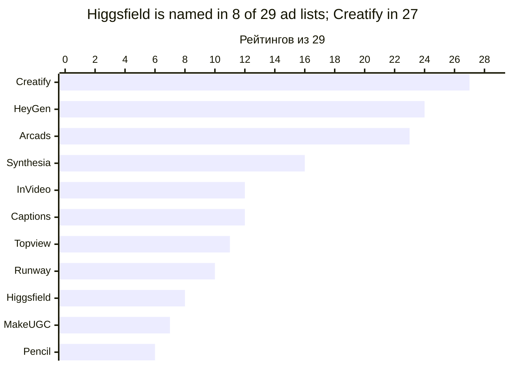
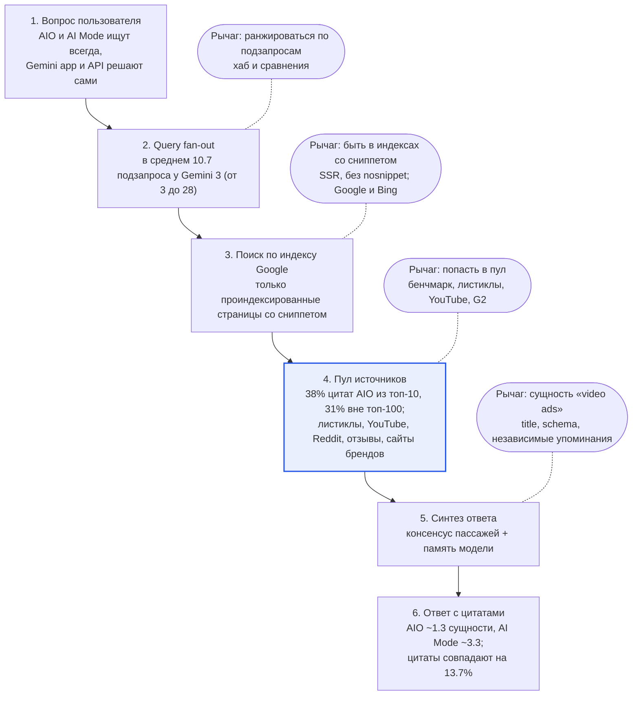

# Higgsfield AEO: разбор презентации и ресёрча

28.10.2026 · презентация: 5 слайдов · репозиторий: https://github.com/Adilforest/higgsfield-aeo

## Как пользоваться документом

Главная мысль всей презентации: **рекламный продукт у Higgsfield есть, но машины его так не воспринимают, а независимые источники его не подтверждают.** Мы чиним сущность бренда, создаём независимый консенсус и меряем результат статистически.

Материалы: презентация (5 слайдов, текст на английском, заметки спикера на русском; текстовая версия в `docs/presentation.md`) и [репозиторий](https://github.com/Adilforest/higgsfield-aeo) (исследования, конфиги, roadmap, трекер).

Для каждого слайда ниже есть четыре блока: что на слайде, что говорить, откуда каждая цифра и какие вопросы ждать. Сводный каталог цифр с источниками, вопросы жюри и глоссарий собраны в конце.

| Слайд | Время | Одна фраза, которую должны запомнить |
| --- | --- | --- |
| 1. Landscape | 60 с | Интент принадлежит Creatify, HeyGen и Arcads; Higgsfield есть в 8 из 29 рейтингов и описан как «cinematic» |
| 2. Diagnosis | 75 с | Ответ Gemini это консенсус многих страниц, и Higgsfield в нём нет; причина в сущности, консенсусе, самопиаре и доверии |
| 3. Opportunities | 45 с | Десять рычагов в четырёх группах; синие строки это ставки |
| 4. Bets | 75 с | Сущность за $0, бенчмарк и аутрич за $1 850, YouTube и G2 за $2 250 |
| 5. Design for scale | 45 с | На 500 интентах меряем кластеры и работаем через хабы цитирования; трекер уже в репозитории |

Пометки достоверности, которые встречаются в отчётах репозитория:

- **\[V\]** проверено напрямую: страница загружена, raw HTML или документация прочитаны.
- **\[S\]** взято из поискового сниппета или вторичного источника, потому что площадка блокирует прямую загрузку.
- **\[I\]** наш вывод или оценка.

Совет перед выступлением: цифры, которые произносишь вслух, открой по ссылкам из раздела «Каталог источников» и посмотри своими глазами. Тогда на вопрос «откуда это?» ответ будет уверенным.

## Как составлялся ресёрч

Ресёрч сделан 28.10.2026 тремя параллельными потоками desk research. Каждый поток отвечал на свой вопрос из ТЗ, искал в вебе, загружал и разбирал страницы и сохранил отчёт в репозиторий с пометками \[V\], \[S\], \[I\] у каждого утверждения.

| Поток | Вопрос | Что делали | Выборка | Отчёт |
| --- | --- | --- | --- | --- |
| 1. Контекст Gemini | Как AI Overviews, AI Mode, Gemini app и Gemini API выбирают источники; верна ли гипотеза «источники = топ 5–10 Google» | Читали официальную документацию Google (Search Central, Gemini API, Terms, цены, анонсы I/O 2026) и количественные исследования; прогнали 7 вариантов запроса и искали «Higgsfield» в HTML выдачи | 37 страниц выдачи, из них 32 сторонних | `docs/research/01-how-gemini-gets-context.md` |
| 2. Продвижение Higgsfield | Кто выигрывает интент, почему не Higgsfield, что делать на $5k | Основной запрос и 9 вариантов; разбор рейтингов с автоматическим извлечением позиций; аудит higgsfield.ai по raw HTML (SSR, robots.txt, llms.txt, sitemap, JSON-LD, OG); отзывные площадки, YouTube, пресса, Wikipedia, Wikidata | 29 ad/UGC-рейтингов + 6 контрольных + 14 по TikTok/avatar/UGC; 14 роликов YouTube | `docs/research/02-higgsfield-promotion.md` |
| 3. Масштабирование | Что ломается на 500 интентах и как перенести подход на другие LLM | Документация API (OpenAI, Perplexity, Anthropic, Gemini), страницы и цены вендоров мониторинга, исследования вариативности ответов; запросы к higgsfield.ai под user-agent ботов; расчёты стоимости | 9 движков, 10+ вендоров | `docs/research/03-scaling.md` |

После сбора мы свели три отчёта: где цифры расходились, брали более свежий и первичный источник. На слайды попали только цифры, которые прослеживаются до конкретной страницы.

### Почему две выборки дают разные числа

Поток 2 нашёл Higgsfield в 8 из 29 рейтингов, поток 1 в 7 из 32 сторонних страниц. Это независимые выборки по разным наборам запросов, и они сходятся в главном: Higgsfield виден примерно в каждом четвёртом источнике и почти нигде не первый. На слайде использована большая и более подробная выборка (29).

### Ограничения, которые нужно знать

- **Реальные ответы AI Overviews и AI Mode не наблюдались.** Мы изучили пул страниц, из которого они собираются. Поиск шёл через сторонний индекс, а не через Google, поэтому это прокси. Первый шаг roadmap — baseline-замер трекером и ручной панелью.
- **Позиции в рейтингах извлечены автоматически**, погрешность около ±1 на длинных страницах.
- **G2, Capterra, Trustpilot и Reddit из сниппетов \[S\].** G2 и Capterra отдают 403, Reddit блокирует прямой доступ.
- **Исследования индустрии меряют по-разному.** Доля цитат AIO из топ-10 в разных работах от 17% до 38%. Направление у всех одно, точное число зависит от методики.
- **Исследование GEO (KDD 2024) делалось на смоделированном генеративном движке и Perplexity**, а не на Gemini. Эффекты +28–41% это ориентир, а не обещание.
- **Бюджет и цели недели 12 — наши оценки \[I\].** Стоимость подписок, панели медиабайеров и креаторов нужно уточнить перед запуском.
- **Модели, цены и синтаксис API актуальны на 28.10.2026.** Эта область меняется ежемесячно: Perplexity, например, вывел из поддержки Sonar API 27.09.2026.

## Слайд 1. Landscape: «Making Higgsfield the #1 answer for AI video ads»

Интент «best AI tool for creating video ads» принадлежит Creatify, HeyGen и Arcads: они есть почти в каждом рейтинге, а Higgsfield в 8 из 29 и обычно на местах #6–#9. Слайд отвечает на пункт ТЗ «Research the current landscape» и одновременно служит обложкой.



*Источник: собственная выборка, 29 ad/UGC-рейтингов, октябрь 2026; `docs/research/02-higgsfield-promotion.md`, раздел A.*

Разрыв между лидером и Higgsfield больше чем троекратный: 27 рейтингов против 8. На самом слайде показаны первые шесть брендов и Higgsfield.

### Что на слайде

- **Слева:** заголовок кейса и абзац с главным выводом: AI-ответ — это консенсус рейтингов, обзоров и видео.
- **Справа:** карточка с полосами «Named in 29 ad/UGC lists». Higgsfield выделен синим, под ним подпись «#1 only on a list that sells top positions».
- **Внизу:** интент, поверхности (AI Overviews, AI Mode, Gemini app), бюджет и дата.

### Что говорить (около 60 секунд)

«Наша задача — сделать Higgsfield первым ответом на вопрос про лучший AI-инструмент для видеорекламы, начиная с Gemini. AI-ответ не придумывается с нуля: он собирается из рейтингов, обзоров и видео. Мы разобрали 29 таких рейтингов. Creatify есть в 27, HeyGen в 24, Arcads в 23. Higgsfield — в 8, обычно на шестом–девятом месте, и пишут о нём как о «cinematic», а не как о рекламном инструменте. Первое место у него только в одном рейтинге, где прямо написано, что места продаются. И ещё факт: в 19 из 29 рейтингов автор ставит на первое место себя. Независимых источников почти нет, и это наше окно.»

### Откуда цифры

**Как собрана выборка.** Основной запрос и 9 вариантов: «best AI video ad generator 2026», «AI tool for UGC video ads», «AI video ads for ecommerce Shopify», «AI ad creative generator video», «best AI tools for TikTok ads», «AI avatar video ads», «Higgsfield vs Creatify», «Higgsfield for ads review», «Higgsfield AI review». По ним собраны и загружены 29 рейтингов про рекламу и UGC. Из каждого автоматически извлечены список продуктов и их порядок (погрешность около ±1 позиции).

**Проверка.** Для сравнения взяты 6 общих рейтингов «best AI video generator» (G2 Learn, Zapier и другие): в них Higgsfield нет ни в одном. Вторая выборка из 14 рейтингов по TikTok, аватарам и UGC дала ту же картину: Creatify и HeyGen в 13 из 14, Higgsfield в 3, из них два написаны конкурентами.

**Где Higgsfield есть.** #1 только на [iTechGuides](https://www.itechguides.com/best/ai-video-ad-makers/), где раскрыто «Vendors can pay for top positions». #2 у Magic Hour и Layer3Labs; #6–#9 у Segwise, Creatify, PixVerse, HyperFX, AdMakeAI. В 5 из 8 случаев его описывают как «cinematic / multi-model». Полная таблица с URL и датами лежит в `docs/research/02-higgsfield-promotion.md`, раздел A.2.

### Вопросы к слайду

- **«Почему вы считаете рейтинги, а не ответы Gemini?»** Рейтинги — это сырьё, из которого Gemini собирает ответ. Вендорские листиклы дают около половины топ-3 цитат AIO для запросов «best X tool». Ответы самих движков мы замеряем трекером на неделе 0.
- **«Ваша выборка не случайна — может, вы просто нашли не те страницы?»** Две независимые выборки по разным наборам запросов дали один и тот же результат: 8 из 29 и 7 из 32. Контрольная группа общих рейтингов показала ноль упоминаний.
- **«Почему нет Veo, Sora и Kling?»** Для этого интента они почти не встречаются: модели воспринимаются как сырьё, а не как готовый рекламный инструмент. Конкуренция здесь между прикладными сервисами.

## Слайд 2. Diagnosis: «The product exists. Machines can’t see it.»

Слайд объясняет причину, а не симптом: ответ Gemini собирается из консенсуса многих страниц, а у Higgsfield в этом консенсусе нет ни правильной категории, ни достаточного присутствия. Это ответ на пункт ТЗ «Diagnose the gap: tell us what you think is causing it».

### Что на слайде

- **Цепочка из пяти шагов:** вопрос пользователя, fan-out на подзапросы, пул источников, сигнал Higgsfield, итоговый ответ. Два последних шага красные: там мы теряем.
- **Строка-вывод:** только 37.9% цитат AI Overviews взяты из органического топ-10.
- **Четыре карточки причин:** Wrong entity, No consensus, Self-claims only, Trust drag.
- **Строка «Not the cause»:** технические блокеры исключены.

### Что говорить (около 75 секунд)

«Продукт для рекламы у Higgsfield есть и он сильный: Marketing Studio делает рекламу по ссылке на товар примерно за 2 минуты. Но машины его не видят. Gemini разбивает вопрос на подзапросы, собирает пул страниц и ищет консенсус. Только около 38% цитат берутся из топ-10 Google, поэтому быть первым в поиске недостаточно. Четыре причины. Первая: машины читают Higgsfield как «camera control», а не как рекламный инструмент. Вторая: Creatify есть почти в каждом рейтинге, Higgsfield в четверти. Третья: компания хвалит себя сама, а самопровозглашённые рейтинги модели не убеждают. Четвёртая: доверие после февраля 2026, и модели выбирают более безопасные бренды. Техника при этом в порядке: боты разрешены, страницы рендерятся на сервере.»

### Откуда цифры и факты

| Утверждение на слайде | Источник | Как получено | Уверенность |
| --- | --- | --- | --- |
| 37.9% цитат AIO из топ-10 (март 2026); в июле 2025 было 76% | [Ahrefs, 03.2026](https://ahrefs.com/blog/ai-overview-citations-top-10/), [Ahrefs, 07.2025](https://ahrefs.com/blog/search-rankings-ai-citations) | 863 тыс. выдач, 4 млн URL | высокая по направлению; BrightEdge даёт \~17%, Surfer \~32% |
| Fan-out: множество параллельных подзапросов | [Google, AI Mode](https://blog.google/products/search/google-search-ai-mode-update/), [AI optimization guide](https://developers.google.com/search/docs/fundamentals/ai-optimization-guide) | официальные формулировки Google | высокая \[V\] |
| Главная и Organization-schema не говорят о рекламе; OG «camera control» | higgsfield.ai | raw HTML главной, /pricing, /ugc, /commercial, 28.10.2026 | высокая \[V\] |
| Creatify в 27 из 29 рейтингов, Higgsfield в 8 (в основном #6–#9) | наша выборка | разбор 29 рейтингов (слайд 1) | высокая \[V\], ±1 позиция |
| \~50 самопромо-страниц на geo.higgsfield.ai | geo.higgsfield.ai | загрузка страниц: нет canonical и JSON-LD, robots.txt и sitemap отдают 500 | высокая \[V\] |
| Пресса февраля 2026 | Forbes, 12.02.2026; The Register, 06.02.2026 | статьи о расистских промо-роликах, выплатах, «unlimited», астротурфинге | высокая \[V\]/\[S\] |
| Wikipedia удалена | архив обсуждения AfD | удалена 31.05.2026: «no reliable WP:CORP third-party source» | высокая \[V\] |
| 79 отзывов на G2 против 1 511 у Creatify | G2 | поисковые сниппеты, G2 отдаёт 403 | средняя \[S\] |
| Not the cause: боты разрешены, SSR работает | higgsfield.ai/robots.txt, raw HTML | все AI-боты Allow: /; /ai-ad-generator отдаёт 1 503 слова без JS | высокая \[V\] |

В заметках слайда есть ещё одна цифра: видимость в AI-ответах коррелирует с упоминаниями бренда (0.656–0.664) сильнее, чем с бэклинками (\~0.21). Источник: [Ahrefs, 75 тыс. брендов](https://ahrefs.com/blog/ai-brand-visibility-correlations/). Это корреляция, а не доказанная причинность.

### Вопросы к слайду

- **«Почему вы уверены, что причина не в техническом SEO?»** robots.txt разрешает всех AI-ботов, рекламные лендинги отдаются с сервера с тысячами слов. Исключения точечные: пустой /pricing и локали, открытые только по ручному списку.
- **«У них же есть собственные рейтинги и geo-страницы, почему не работает?»** По целевым запросам они не ранжируются, а модели ищут независимое подтверждение. Часть geo-страниц при этом рискует попасть под политику Google о scaled content abuse.
- **«Репутация — это зона PR, при чём тут AEO?»** Модели пересказывают то, что находят. Пока по запросу «Higgsfield review» доминируют жалобы и обзоры конкурентов, в коммерческих ответах появятся оговорки. Поэтому trust-страница есть в списке возможностей.

## Слайд 3. Opportunities: «Ten opportunities to close the gap»

Десять возможностей закрывают четыре причины со слайда 2: сущность (1–3), консенсус (4–6), сторонние доказательства (7–8) и доверие (9–10). Это ответ на пункт ТЗ «What → Why it matters → Expected impact → Difficulty». Синие строки входят в три ставки следующего слайда.

### Как ставились оценки

- **Impact** — ожидаемый эффект на AI Overviews, AI Mode и Gemini. Считали по тому, какую причину закрывает действие и насколько сильны данные о связи этого рычага с цитированием. Это экспертная оценка \[I\], а не измерение.
- **Effort** — время команды, деньги и зависимость от третьих лиц. Low = дни работы своей команды; Med = недели и внешние участники.

### Обоснование каждой строки

| # | Возможность | Какую причину закрывает | На чём основана оценка |
| --- | --- | --- | --- |
| 1 | Хаб /ai-video-ads, слияние 9 лендингов | неверная сущность, дробление сигнала | 9+ пересекающихся страниц для одной функции \[V\]; на /ai-ad-generator с главной нет ни одной ссылки \[V\] |
| 2 | Entity-сигналы: title, schema, OG | неверная сущность | тексты, которые читают краулеры, не содержат «ads» \[V\]; делается за 2–3 дня |
| 3 | Цены в HTML + страница фактов | нет машиночитаемых фактов | /pricing отдаёт 66 слов без цен \[V\]; сторонние сайты приводят противоречащие сетки \[S\]; боты ChatGPT и Perplexity обычно не исполняют JS |
| 4 | Бенчмарк: 120 роликов, 6 инструментов | нет консенсуса, самопиар | GEO: цитаты +41%, статистика +33%, ссылки на источники +28% ([Aggarwal et al., KDD 2024](https://arxiv.org/abs/2311.09735)); нейтральной авторитетной страницы под интент нет \[V\] |
| 5 | Аутрич в рейтинги | нет консенсуса | вендорские листиклы дают 51% топ-3 цитат AIO в SaaS-запросах ([AUQ](https://auq.io/blog/ai-overview-citations-what-appears-for-best-product-searches-original-data/)); список из 12 целевых страниц в `config/campaigns/gemini.yaml` |
| 6 | Страницы сравнения vs Creatify, Arcads | fan-out на «X vs Y» и «alternatives» | HeyGen уже перехватывает брендовый спрос страницей [Higgsfield alternatives](https://www.heygen.com/blog/higgsfield-alternatives) \[V\] |
| 7 | YouTube-серия «tested» + 2 креатора | нет сторонних доказательств | YouTube — самый цитируемый домен AIO ([Ahrefs](https://ahrefs.com/blog/most-cited-domains-ai-overviews/), BrightEdge); YouTube-упоминания дают самую сильную корреляцию с AI-видимостью (0.737); ни один из 14 топовых роликов про AI UGC ads не упоминает Higgsfield \[V\] |
| 8 | Программа отзывов G2 / Capterra | нет сторонних доказательств | 79 отзывов против 1 511 \[S\]; отзывные площадки есть в 17% AIO по «best/top» и в 49% по «… reviews» ([SE Ranking](https://seranking.com/blog/review-platforms-in-ai-overviews/)), поэтому Impact только Med |
| 9 | Trust-страница «what we changed» | доверие | Trustpilot 4.0 из 5, 19% единиц, темы: кредиты, возвраты, автопродления \[S\]; конкуренты пишут негативные «Higgsfield review» \[V\] |
| 10 | Гигиена: geo-субдомен, Wikidata | самопиар, доверие | robots.txt и sitemap поддомена отдают 500 \[V\]; дубль Wikidata Q141663132 с опечаткой в домене higsfield.io \[V\] |

### Что говорить (около 45 секунд)

«Десять возможностей, сгруппированных по четырём причинам. Первые три чинят сущность и стоят почти ноль. Дальше идут консенсус и сторонние доказательства: бенчмарк, рейтинги, YouTube и отзывы. Заканчиваем доверием и гигиеной. Синие строки — это то, что мы делаем первыми. Чего мы сознательно не делаем: не покупаем места в рейтингах, не пишем фейковые отзывы и не прячем текст для LLM.»

### Сознательно не включено

- **Schema и llms.txt как отдельные рычаги.** Ahrefs (05.2026) не нашёл заметного эффекта JSON-LD на цитирование, SE Ranking (10.2026) не нашёл корреляции llms.txt с цитированием, Google пишет, что специальная разметка не нужна. Они входят в пункт 2 как гигиена.
- **Платные места в рейтингах, фейковые отзывы, скрытый текст для LLM, массовые страницы под промпты.** Это нарушения правил FTC и спам-политик Google. Кроме того, бренд уже обвиняли в астротурфинге.

### Вопросы к слайду

- **«Как вы оценили Impact?»** Экспертно, по связи с причиной и по данным исследований о рычаге. Проверять будем экспериментами: тестовые и контрольные кластеры интентов в `config/campaigns/gemini.yaml`.
- **«Почему G2 только Med, если отрыв в 20 раз?»** В ответах на «best X» отзывные площадки цитируются редко. G2 важен для запросов «Higgsfield reviews» и «X vs Y», а редакционный список G2 станет доступен после роста числа отзывов.
- **«Почему бы просто не заплатить за первое место в рейтингах?»** Платная позиция без пометки нарушает правила FTC. С пометкой sponsored она мало что даёт: на единственном рейтинге, где Higgsfield первый, прямо написано про платные позиции, и на общий консенсус это не повлияло.

## Слайд 4. Bets: «Three bets for the first 8 weeks»

Три ставки выбраны по правилу «сначала фундамент, потом главная причина, потом самый цитируемый канал». Они обойдутся в $4 100 из $5 000, ещё $900 идут на мониторинг и резерв. Это ответ на пункт ТЗ «Pick your bets» и на вопрос о бюджете.

### Три ставки и логика выбора

| Ставка | Сроки | Бюджет | Почему именно она |
| --- | --- | --- | --- |
| 1. Единая сущность: хаб /ai-video-ads, entity-сигналы, цены в HTML | недели 1–2 | $0, время команды | Фундамент: всё, что мы заработаем дальше, должно вести на одну страницу и одну формулировку. Дёшево и быстро |
| 2. Бенчмарк + аутрич в рейтинги | недели 2–8 | $1 850 | Бьёт в главную причину (нет консенсуса). Нейтральной страницы под интент нет, первый честный тест может стать опорным источником |
| 3. YouTube-тесты + отзывы G2 | недели 3–8 | $2 250 | YouTube — самый цитируемый домен AIO и сильнейший коррелят видимости. Для видео-продукта естественный канал |

Почему не другие пункты: сравнения (6), trust-страница (9) и гигиена (10) делаются параллельно за $0 силами команды. Ставки — это то, куда идут деньги и фокус.

### Бюджет по статьям

| Статья | Сумма | Из чего сложилась оценка \[I\] |
| --- | --- | --- |
| Бенчмарк | $1 500 | подписки на 5 конкурентов на месяц $600; слепая панель из 5 медиабайеров по $120 = $600; дизайн отчёта $300 |
| PR и аутрич | $350 | сервис запросов журналистов и рассылка релиза |
| YouTube | $1 500 | 2 независимых креатора по $600 с пометкой paid partnership; монтаж 6 роликов $300 |
| Отзывы G2 / Capterra | $750 | около 30 отзывов × $25 через официальную программу площадки, без фильтра по тональности |
| Мониторинг | $400 | трекер промптов на 2 месяца; собственный трекер дешевле: 5 000 поисков Gemini в месяц бесплатно |
| Резерв | $500 | вторая волна аутрича или третий креатор |
| **Итого** | **$5 000** |  |

Все суммы это наши оценки, а не котировки. Перед запуском проверь цены подписок конкурентов и ставки креаторов.

### Цель недели 12 и почему не «сразу #1»

Цель: Higgsfield назван в ≥ 60% ответов и попадает в топ-3 в ≥ 30%. Это наша оценка \[I\], а не взятая из исследования цифра. Она ставится относительно baseline, который мы снимаем в неделю 0.

Первое место по главному интенту за 8 недель нереалистично: Creatify есть в 27 из 29 рейтингов. Поэтому путь — лестница:

1. присутствие в ответах;
2. топ-3;
3. первое место в подинтентах, где продукт сильнее всего («реклама по ссылке на товар», cinematic и UGC);
4. затем head-интент.

Лестница по неделям зафиксирована в `config/campaigns/gemini.yaml` (блок `goal.ladder`) и в ROADMAP.md.

### Что говорить (около 75 секунд)

«Первая ставка стоит ноль: один хаб вместо девяти лендингов и слова «video ads» везде, где читают машины. Без этого любая статья или видео уведут на страницу про camera control. Вторая ставка — открытый бенчмарк: 120 роликов в шести инструментах, слепая оценка медиабайеров, сырые данные открыты, проигрыши показаны честно. С ним идём в рейтинги, из которых Gemini собирает ответ. Третья — YouTube и G2: самый цитируемый домен в AI Overviews и сторонние отзывы. К неделе 12 хотим упоминание в 60% ответов и топ-3 в 30%. Первое место берём сначала в подинтентах, где продукт сильнее.»

### Вопросы к слайду

- **«А если в бенчмарке Higgsfield проиграет?»** Публикуем всё равно: честно показанный проигрыш и есть сигнал доверия. Проигрыши превращаем в задачи для продукта, а позиционируемся там, где выиграли.
- **«Почему не потратить всё на креаторов?»** Без бенчмарка им нечего сравнивать, а без хаба их трафик уйдёт на страницы про camera control. Ставки зависят друг от друга.
- **«Как поймёте, что сработало именно ваше действие?»** Тестовые кластеры (video ads) сравниваем с контрольными (AI-фото, музыкальные клипы), у которых нет общих источников, методом difference-in-differences.

## Слайд 5. Design for scale: «500 intents: measure clusters, act on hubs»

На 500 интентах единица работы меняется: измеряем кластеры интентов, а действуем через несколько доменов, которые цитируются по многим интентам сразу. Это ответ на пункт ТЗ «Design for scale: what would break, show how you would redesign it». В футере слайда ссылка на [репозиторий](https://github.com/Adilforest/higgsfield-aeo), где всё это уже реализовано.

### Что на слайде

Верхний ряд — новый конвейер из пяти шагов:

1. **Intent registry:** 500 интентов × 3 формулировки, хранятся в YAML в Git.
2. **Tiered sampling:** топ-100 интентов еженедельно (3 формулировки × 5 прогонов), остальные 400 раз в две недели (2 × 3).
3. **Engine runners:** четыре официальных API (Gemini, ChatGPT, Perplexity, Claude) и SERP-вендор для AI Overviews, AI Mode и Copilot.
4. **Metrics + CI:** mention rate с доверительным интервалом, top-1, citation share.
5. **Hub backlog:** задачи на контент, PR, отзывы и Reddit по самым весомым источникам.

Нижний ряд — четыре пары «что ломается → как чиним»:

| Что ломается | Цифра на слайде и её источник | Как чиним |
| --- | --- | --- |
| Ручная проверка | 35 тыс. ответов за цикл = 500 интентов × 7 поверхностей × 10 прогонов; наш расчёт \[I\] | API-раннеры + ежемесячная сверка с интерфейсом |
| Один промпт | Шанс получить тот же список брендов дважды меньше 1 из 100; SparkToro и Gumshoe, 2 961 ответ ChatGPT, Claude, AIO/AI Mode \[V\] | Кластеры × формулировки × повторные прогоны, доверительный интервал |
| Страница на каждый интент | 500 страниц попадают под политику Google о scaled content abuse | Выигрываем несколько доменов, цитируемых везде |
| Атрибуция | Модели, PR и контент меняются одновременно | Тестовые и контрольные кластеры, difference-in-differences |

### Расчёты из заметок спикера

- **Объём:** около 11.7 тыс. прогонов на один движок в месяц при такой схеме сэмплинга \[I\].
- **Стоимость:** примерно $1.2–1.8 тыс. в месяц на API против около $80 тыс. при наивной схеме (500 × 3 × 10 × 6 движков ежедневно). Оценка по прайсам провайдеров на 28.10.2026, уверенность средняя: стоимость зависит от длины ответов \[I\].
- **Статистика:** чтобы увидеть рост mention rate с 20% до 40%, нужно около 82 независимых наблюдений на группу. Для сдвига с 30% до 40% уже около 356. Поэтому меряем кластеры, а не отдельные промпты.
- **Вендоры:** почти все гоняют промпт примерно раз в день на движок. По данным Evertune, при 5 повторах погрешность ±27 п.п., при 100 ±6 п.п.
- **Buy vs build:** покупаем один UI-вендор (Peec AI или Profound) как эталон интерфейса. Свой тонкий слой статистики, графа хабов и экспериментов строим сами: у вендоров этого нет в нужной глубине.

### Перенос на другие LLM

Сущность, бенчмарк, сравнения и отзывы переиспользуются. Меняются поисковый индекс и главный рычаг:

| Движок | Откуда берёт источники | Что добавить к Gemini-кампании |
| --- | --- | --- |
| ChatGPT | собственный индекс + Bing; 87% цитат совпадают с топом Bing (Seer) | Bing Webmaster Tools, IndexNow, ранжирование хаба в Bing |
| Copilot | Bing | то же + свежесть страниц сравнения |
| Perplexity | собственный индекс; Reddit даёт 46.7% среди топ-10 доменов (Profound) | Reddit, датированные таблицы с данными |
| Claude | Brave Search | индексация в Brave, Claude-SearchBot и Claude-User в robots.txt |

Конфиги по каждому движку лежат в `config/campaigns/`.

### Что говорить (около 45 секунд)

«На 500 интентах ломаются четыре вещи. Ручная проверка не справится с 35 тысячами ответов. Один промпт — это шум: один и тот же список брендов дважды подряд выпадает реже чем в одном случае из ста. Страница на каждый интент — это спам в глазах Google. И без контрольной группы нельзя доказать эффект. Поэтому меряем кластеры статистически, а действуем через несколько доменов, которые цитируются везде. Трекер для этого уже написан и лежит в репозитории: он опрашивает Gemini, ChatGPT, Perplexity и Claude и разворачивает таксономию в 500 интентов.»

### Вопросы к слайду

- **«Откуда 500 интентов?»** Из таксономии: 15 сценариев использования × 10 персон × 6 платформ × 6 конкурентов × 7 шаблонов формулировок. Комбинации ранжируются по весу и обрезаются до 500. В боевом режиме веса калибруются по данным из Search Console, Reddit и оценкам объёма AI-запросов.
- **«Ответ API не равен тому, что видит пользователь?»** Да: по брендам они совпадают лишь на 15–32% (исследование Surfer, 2026). Поэтому API служит дешёвым индикатором тренда, а эталоном остаётся UI-вендор и ежемесячная сверка.
- **«А вы имеете право мониторить через Gemini API?»** Условия Gemini API запрещают автоматически собирать и анализировать ссылки из grounding. Перед масштабированием нужна юридическая проверка, запасной путь — SERP-вендор или ручная панель. В трекере раскрытие ссылок по умолчанию выключено.

## Справочник: как Gemini собирает ответ

Гипотеза «источники AI Overviews = первые 5–10 ссылок Google» для 2026 года неверна. Ответ собирается из пула страниц, найденных по многим подзапросам, и только 38% цитат берутся из топ-10 по исходному запросу.



*Шаг 4 выделен: именно в пуле источников Higgsfield сейчас проигрывает.*

Шесть шагов идут сверху вниз, справа отмечено, на каком шаге действует каждый рычаг Higgsfield. Шаг 4 выделен: именно в пуле источников Higgsfield сейчас проигрывает.

Лучший предиктор цитирования — ранжироваться и по основному запросу, и по подзапросам: 51.2% цитируемых страниц ранжируются по основному запросу и хотя бы по одному fan-out, и только 19.6% лишь по основному ([Surfer](https://surfer.ai/blog/query-fan-out/)).

| Поверхность | Когда ищет | Модель (окт. 2026) | Влияние Google-Extended |
| --- | --- | --- | --- |
| AI Overviews | всегда; показывается, когда ответ добавляет ценности | Gemini 3 (с января 2026) | не влияет |
| AI Mode | всегда; Deep Search делает до сотен запросов | Gemini 3.5 Flash по умолчанию | не влияет |
| Gemini app | модель решает сама; без поиска ссылок нет | 3 Flash, 3.6 Flash, 4 Argon | управляет grounding |
| Gemini API | модель решает сама | выбор разработчика, для трекера `gemini-3.8-flash` | в Vertex управляет точно |

Источники: [AI optimization guide](https://developers.google.com/search/docs/fundamentals/ai-optimization-guide), [Google crawlers](https://developers.google.com/crawling/docs/crawlers-fetchers/google-common-crawlers), [Ahrefs: AIO vs AI Mode](https://ahrefs.com/blog/ai-overviews-vs-ai-mode/), [Gemini release notes](https://gemini.google/release-notes/). Подробности — в `docs/research/01-how-gemini-gets-context.md`.

Почему это важно для Higgsfield: если Gemini отвечает без поиска, он опирается на память, а в памяти Higgsfield связан с «cinematic video», а не с «video ads». Это можно проверить трекером: сравнить прогоны `gemini` и `gemini-memory`.

## Каталог источников

Каждая цифра презентации с источником и уровнем уверенности. Полные списки ссылок даны в конце каждого отчёта в `docs/research/`.

| Цифра или факт | Слайд | Источник | Уверенность |
| --- | --- | --- | --- |
| Creatify 27, HeyGen 24, Arcads 23, Synthesia 16, InVideo 12, Captions 12 из 29 рейтингов; Higgsfield 8 | 1, 2 | собственная выборка, список URL в `docs/research/02`, раздел A.2 | высокая \[V\], позиции ±1 |
| 19 из 29 рейтингов ставят на #1 свой продукт | 1 | та же выборка | высокая \[V\] |
| Higgsfield #1 только на рейтинге с платными позициями | 1 | [iTechGuides](https://www.itechguides.com/best/ai-video-ad-makers/): «Vendors can pay for top positions» | высокая \[V\] |
| 37.9% цитат AIO из топ-10 (03.2026), 76% (07.2025) | 2 | [Ahrefs 03.2026](https://ahrefs.com/blog/ai-overview-citations-top-10/), [Ahrefs 07.2025](https://ahrefs.com/blog/search-rankings-ai-citations) | высокая по направлению |
| Корреляции с AI-видимостью: YouTube-упоминания 0.737, упоминания бренда 0.656, бэклинки \~0.21 | 2, 3, 4 | [Ahrefs, 75 тыс. брендов](https://ahrefs.com/blog/ai-brand-visibility-correlations/) | высокая; это корреляция |
| GEO: цитаты +41%, статистика +33%, ссылки на источники +28% | 3 | [Aggarwal et al., KDD 2024](https://arxiv.org/abs/2311.09735) | средняя: смоделированный движок, не Gemini |
| YouTube — самый цитируемый домен AIO (22.9% среди топ-50 доменов) | 3, 4 | [Ahrefs, 09.2026](https://ahrefs.com/blog/most-cited-domains-ai-overviews/), [BrightEdge](https://www.brightedge.com/resources/weekly-ai-search-insights/youtube-presence-ai-search) | высокая; доли расходятся по методике |
| Вендорские листиклы = 51% топ-3 цитат AIO в SaaS | 3 | [AUQ, 05.2026](https://auq.io/blog/ai-overview-citations-what-appears-for-best-product-searches-original-data/) | средняя: 100 запросов |
| Отзывные площадки в 17.1% AIO по «best/top» против 49% по «reviews» | 3 | [SE Ranking](https://seranking.com/blog/review-platforms-in-ai-overviews/) | средняя |
| G2: 79 отзывов у Higgsfield, 1 511 у Creatify | 2, 3 | поисковые сниппеты G2 | средняя \[S\] |
| Trustpilot 4.0 из 5, 5 198 отзывов, 19% единиц | 3 | [Trustpilot](https://www.trustpilot.com/review/higgsfield.ai) | средняя \[S\] |
| Пресса февраля 2026 | 2 | [The Register, 06.02.2026](https://theregister.com/2026/02/06/higgsfield_ai_job_loss), [Forbes, 12.02.2026](https://www.forbes.com.au/?p=177110) | высокая |
| Wikipedia удалена 31.05.2026, черновик ждёт проверки | 2 | [AfD](https://en.wikipedia.org/wiki/Wikipedia:Articles_for_deletion/Higgsfield_AI), [Draft](https://en.wikipedia.org/wiki/Draft:Higgsfield_AI) | высокая \[V\] |
| Дубль в Wikidata с опечаткой в домене | 3 | [Q140561494](https://www.wikidata.org/wiki/Q140561494), [Q141663132](https://www.wikidata.org/wiki/Q141663132) | высокая \[V\] |
| Marketing Studio: реклама по ссылке за \~2 минуты, 9 режимов, 40+ аватаров, Seedance 2.0 | 2 | страницы higgsfield.ai/ai-ad-generator и /marketing-studio-intro | высокая \[V\]; «2 минуты» — заявление вендора |
| /pricing: 66 слов без цен; /ai-ad-generator: 1 503 слова в raw HTML | 2, 3 | загрузка raw HTML 28.10.2026 | высокая \[V\] |
| Тот же список брендов дважды: меньше 1 из 100 | 5 | [SparkToro и Gumshoe](https://sparktoro.com/blog/new-research-ais-are-highly-inconsistent-when-recommending-brands-or-products-marketers-should-take-care-when-tracking-ai-visibility/) | высокая \[V\] |
| Погрешность ±27 п.п. при 5 повторах, ±6 при 100 | 5 | [Evertune](https://www.evertune.ai/resources/insights-on-ai/how-many-repetitions-of-a-single-prompt-does-it-take-to-understand-your-ai-visibility) | высокая \[V\] |
| API и интерфейс совпадают по брендам на 15–32% | 5 | [Surfer, 2026](https://surfer.ai/blog/llm-scraped-ai-answers-vs-api-results) | высокая \[V\] |
| 35 тыс. ответов за цикл; 11.7 тыс. прогонов на движок; $1.2–1.8 тыс. против $80 тыс. в месяц | 5 | наш расчёт по прайсам провайдеров, `docs/research/03`, разделы 3 и 4e | средняя \[I\] |
| Gemini API: `gemini-3.8-flash`, grounding только на платном тарифе, 5 000 поисков в месяц бесплатно, далее $14 за 1 000 | 5, справочник | [Gemini API pricing](https://ai.google.dev/gemini-api/docs/pricing), [grounding](https://ai.google.dev/gemini-api/docs/google-search) | высокая \[V\] |
| Perplexity Sonar API выведен из поддержки 27.09.2026 | 5, репозиторий | [Perplexity: миграция с Sonar](https://docs.perplexity.ai/docs/agent-api/migrate-from-sonar/overview.md) | высокая \[V\] |
| Доли AI-трафика: ChatGPT \~53%, Gemini 27–28% (05.2026) | веса движков | [Similarweb](https://aisearch.similarweb.com/blog/gen-ai-stats/) | средняя |

## Вопросы жюри и готовые ответы

Вопросы к конкретным слайдам разобраны в их разделах. Здесь собраны общие вопросы, которые вероятнее всего зададут за 5 минут Q&A.

1. **«Вы видели реальную выдачу AI Overviews?»** Напрямую нет, и мы этого не скрываем. Мы изучили пул страниц, из которого собирается ответ: 29 рейтингов и контрольную выборку. Первый шаг плана — baseline: трекер через Gemini API и ручная панель из 10 промптов на трёх поверхностях Google.
2. **«Почему начинаете с Gemini, а не с ChatGPT?»** Доля Gemini в AI-трафике выросла примерно с 9% до 27–28% за год, а AI Overviews видят больше 2.5 млрд пользователей в месяц. Кроме того, Gemini API показывает подзапросы, которые модель отправляет в Google, и это удобная измеримая точка старта. Основная работа (сущность, консенсус, YouTube) переносится на другие движки почти без изменений, а Bing-часть для ChatGPT и Copilot начинаем уже на неделе 2.
3. **«Реально стать #1?»** По head-интенту за 8 недель нет: Creatify есть в 27 из 29 рейтингов. Путь — лестница: присутствие, топ-3, первое место в подинтентах, где продукт сильнее (реклама по ссылке на товар). Цель на 26-ю неделю — top-1 в 30% ответов на этих подинтентах.
4. **«Что сделаете в первые 48 часов?»** Снимем baseline, запустим юридическую проверку условий Gemini API, подготовим бриф хаба /ai-video-ads и список новых title и OG-текстов, подключим Bing Webmaster Tools.
5. **«Что если Google поменяет алгоритм?»** Мы вкладываемся в то, что работает на всех движках: понятная сущность, независимые упоминания, данные. А не в трюки под конкретный алгоритм. Смена модели в нашей системе фиксируется как разрыв ряда и требует нового baseline.
6. **«А как же llms.txt и schema?»** Делаем как гигиену за ноль, но не считаем рычагом. Google пишет, что специальная разметка не нужна. Ahrefs и SE Ranking не нашли заметной связи ни с цитированием, ни с видимостью.
7. **«Ваш план затрагивает продукт?»** Да. Конкуренты закрепляют конкретные претензии: нет прямого запуска в Meta и TikTok, нет batch-вариаций, «credit math». Их нужно закрыть в продукте или опровергнуть фактами с датой, иначе модели будут их пересказывать.
8. **«Как вы докажете, что рост от вас?»** Тестовые и контрольные кластеры интентов без общих источников, метод difference-in-differences и журнал всех изменений (intervention log). Результат показываем с доверительным интервалом, а не скриншотом.
9. **«Сколько стоит поддерживать систему на 500 интентах?»** Примерно $1.2–1.8 тыс. в месяц на API, один UI-вендор (от сотен долларов до нескольких тысяч) и 0.5–1 ставки аналитика-инженера. Это наша оценка.
10. **«Не проще ли написать отзывы и посты на Reddit самим?»** Нет. У бренда уже были обвинения в астротурфинге, новый эпизод обойдётся дороже любого выигрыша. Правило FTC от 14.08.2024 позволяет штрафовать за фейковые отзывы, а Google фильтрует неаутентичные упоминания. Полный список запретов в `config/campaigns/shared.yaml`.

## Глоссарий

| Термин | Что значит |
| --- | --- |
| AEO (Answer Engine Optimization) | Работа над тем, чтобы AI-ассистенты называли и цитировали бренд в ответах |
| GEO (Generative Engine Optimization) | То же самое в академической терминологии; так называется исследование KDD 2024 |
| AI Overviews (AIO) | Краткий AI-ответ над обычной выдачей Google |
| AI Mode | Режим поиска Google в формате диалога; с I/O 2026 продолжает AIO как follow-up |
| Gemini app | Чат-ассистент gemini.google.com |
| Grounding | Привязка ответа модели к найденным в поиске источникам |
| Query fan-out | Разбиение вопроса на много подзапросов, которые движок ищет параллельно |
| Retrieval pool | Набор страниц, найденных по всем подзапросам, из которого модель собирает ответ |
| Параметрическая память | То, что модель знает из обучения без поиска |
| Сущность (entity) | То, как машины понимают бренд: категория, функции, связи |
| Листикл | Статья-рейтинг вида «Best AI video ad generators 2026» |
| Citation hub | Домен или страница, которую цитируют по многим интентам сразу |
| Mention rate | Доля ответов, в которых бренд вообще назван |
| Top-1 rate | Доля ответов, где бренд назван первым |
| Citation share | Доля ссылок на собственный домен среди всех цитат ответа |
| Share of voice | Доля упоминаний бренда среди всех упоминаний отслеживаемых конкурентов |
| Wilson CI | Доверительный интервал для доли; показывает, насколько цифра надёжна при малой выборке |
| Difference-in-differences | Сравнение изменения в тестовой группе с изменением в контрольной, чтобы отделить эффект от фона |
| SSR | Серверный рендеринг: текст страницы есть в HTML без выполнения JavaScript |
| JSON-LD / schema | Машиночитаемая разметка страницы (организация, продукт, FAQ) |
| llms.txt | Файл с кратким описанием сайта для LLM; доказанного эффекта нет |
| Google-Extended | Токен robots.txt для обучения Gemini и grounding в Gemini app; на AIO и AI Mode не влияет |
| IndexNow | Протокол мгновенного уведомления Bing и других поисковиков о новых страницах |
| Scaled content abuse | Политика Google против массового выпуска малоценных страниц |
| Астротурфинг | Имитация независимых отзывов и обсуждений от имени компании |

## Репозиторий и трекер

Всё, о чём говорит презентация, лежит в публичном [репозитории higgsfield-aeo](https://github.com/Adilforest/higgsfield-aeo). Там же есть копия этого документа: `docs/speaker-guide.md`.

| Путь | Что внутри | К какому слайду |
| --- | --- | --- |
| `docs/research/01-how-gemini-gets-context.md` | как AIO, AI Mode, Gemini app и Gemini API выбирают источники | 2 |
| `docs/research/02-higgsfield-promotion.md` | ландшафт, аудит, диагноз, 10 возможностей, бюджет | 1–4 |
| `docs/research/03-scaling.md` | карта движков, API для мониторинга, 500 интентов, архитектура | 5 |
| `config/campaigns/gemini.yaml` | конфигурация Gemini-кампании: поверхности, подзапросы, 12 целевых рейтингов, эксперименты | 3, 4 |
| `config/campaigns/shared.yaml` | общая сущность, активы и запрещённые тактики | 3, 4 |
| `config/campaigns/{chatgpt,perplexity,claude,copilot}.yaml` | что добавить для каждого движка | 5 |
| `ROADMAP.md` | фазы, контрольные пороги, бюджет | 4, 5 |
| `site/` | robots.txt, JSON-LD, спецификация хаба, раздел llms.txt | 3, 4 |
| `config/intents/` | пилотная панель, таксономия, 500 сгенерированных интентов | 5 |
| `aeo/`, `tests/` | трекер видимости и тесты | 5 |

### Как запустить трекер

```bash
pip install -r requirements.txt
export GEMINI_API_KEY=...   # ключ с включённым биллингом
python -m aeo run --engines gemini,gemini-memory --samples 5
```

Результат появится в `runs/<дата>/report.md`. В отчёте будет доля ответов с Higgsfield (с поиском и без него), лидеры среди конкурентов, чаще всего цитируемые домены и реальные подзапросы, которые Gemini отправил в Google. Сравнение прогонов с поиском и без него показывает, связывает ли модель Higgsfield с рекламой в собственной памяти.

### Что ещё не сделано

- [ ] Реальный baseline-прогон: нужен ключ Gemini API с биллингом.
- [ ] Ручная проверка AI Overviews, AI Mode и Gemini app со скриншотами.
- [ ] Юридическая проверка условий Gemini API для мониторинга.
- [ ] Проверка цен для бюджета: подписки конкурентов, ставки креаторов и медиабайеров.
- [ ] Заполнение `config/brand_facts.yaml` фактами от продукта (цены, экспорт, лицензия).
